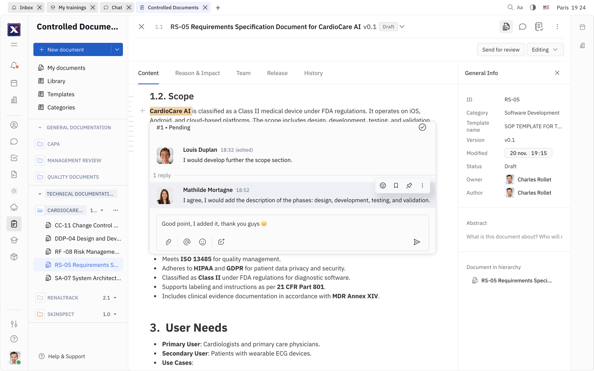

# TraceX

[](#licensing)

Built for compliance and productivity across regulated industries.


## About

TraceX is an all-in-one platform built on Huly platform technology, helping teams manage risks, quality processes, development and test activities, technical documentation, and compliance across the full product lifecycle.

Built for consultants, startups, and established companies, TraceX adapts to your processes while keeping teams audit-ready.

Whether you are targeting GxP, CE, FDA, or ISO standards, TraceX helps simplify compliance and operational execution.

## What is TraceX?

Think of TraceX as a single workspace for quality, product development, and compliance.

It enables your team to:

- Maintain structured quality processes and traceability
- Align development and verification work with regulatory expectations
- Prepare continuously for internal and external audits
- Scale workflows from early-stage products to mature organizations

Compliance can be complicated. TraceX makes it simple.

## Core Pillars

### Electronic Quality Management System (eQMS)

Manage document versions with audit trails, approval workflows, and electronic signatures; track training and risk activities; and prepare for audits in one intuitive and customizable platform.

Built to adapt to your needs and keep you always audit-ready.

### Product Lifecycle Management (PLM)

Track and manage your product lifecycle from concept to market release and post-market surveillance.

Teams collaborate on design control, requirement specifications, development, and verification and validation while maintaining compliance at every stage.

## Changelog

For detailed information about changes, improvements, and bug fixes in each version, see our [Changelog](./changelog.md).

## Versions

The TraceX platform uses two types of version tags to distinguish between production-ready and development releases:

- **Production Versions (`v*`)** - Stable releases for end users
  - Example: `v0.7.310`, `v0.7.307`, `v0.6.501`
  - These versions are recommended for production deployments
  - Suitable for self-hosted installations
  - Published with release notes on [GitHub Releases](https://github.com/hcengineering/platform/releases)

- **Development Versions (`s*`)** - Pre-release builds for developers
  - Example: `s0.7.313`, `s0.7.292`, `s0.7.288`
  - Used for development and testing purposes
  - May contain experimental features or bug fixes
  - Not recommended for production use

## Architecture

For detailed information about the platform architecture, services, and their interactions, see our [Architecture Overview](./ARCHITECTURE_OVERVIEW.md).

## Licensing

TraceX is built on the open-source [Huly Platform](https://github.com/hcengineering/platform). Code inherited or modified from Huly, as well as new source files by default, is licensed under the [Eclipse Public License 2.0](./LICENSE).

Some separately designated TraceX-original packages are licensed under the [PolyForm Shield License 1.0.0](./LICENSE-POLYFORM-SHIELD), which permits use and modification but restricts building competing products with them.

Source file headers and package metadata identify the applicable license. Mixed packages use the SPDX `AND` form, such as `(EPL-2.0 AND LicenseRef-PolyForm-Shield-1.0.0)`.

## Table of Contents

- [TraceX](#tracex)
  - [About](#about)
  - [What is TraceX?](#what-is-tracex)
  - [Core Pillars](#core-pillars)
    - [Electronic Quality Management System (eQMS)](#electronic-quality-management-system-eqms)
    - [Product Lifecycle Management (PLM)](#product-lifecycle-management-plm)
  - [Changelog](#changelog)
  - [Versions](#versions)
  - [Architecture](#architecture)
  - [Licensing](#licensing)
  - [Table of Contents](#table-of-contents)
  - [Pre-requisites](#pre-requisites)
  - [Verification](#verification)
  - [Branches \& Contributing](#branches--contributing)
  - [Setup dev environment](#setup-dev-environment)
    - [Authentication](#authentication)
  - [Fast start](#fast-start)
  - [Installation](#installation)
  - [Build and run](#build-and-run)
  - [Run in development mode](#run-in-development-mode)
  - [Update project structure and database](#update-project-structure-and-database)
  - [Troubleshooting](#troubleshooting)
  - [Build \& Watch](#build--watch)
  - [Tests](#tests)
    - [Continuous integration](#continuous-integration)
    - [Unit tests](#unit-tests)
    - [UI tests](#ui-tests)
  - [Package publishing](#package-publishing)
  - [Additional testing](#additional-testing)
  - [WSL build guide](#wsl-build-guide)
    - [Prerequisites](#prerequisites)
      - [Disk Space Requirements](#disk-space-requirements)
      - [Docker WSL Integration](#docker-wsl-integration)
    - [Common Issues and Solutions](#common-issues-and-solutions)
      - [Git Line Endings on Windows](#git-line-endings-on-windows)
      - [Elevated Privileges in WSL](#elevated-privileges-in-wsl)
      - [WSL Configuration](#wsl-configuration)
    - [Running the Application](#running-the-application)
      - [Port Conflicts](#port-conflicts)

## Pre-requisites

- Before proceeding, ensure that your system meets the following requirements:
  - [Node.js](https://nodejs.org/en/download/) (v20.11.0 is required)
  - [Docker](https://docs.docker.com/get-docker/)
  - [Docker Compose](https://docs.docker.com/compose/install/)

If you use `nvm`, run this after entering the repo to align your shell with the repository Node version:

```bash
nvm use
```

## Verification

To verify the installation, perform the following checks in your terminal:

- Ensure that the `docker` commands are available:

```bash
docker --version
docker compose version
```

## Branches & Contributing

- The `main` branch is the default branch used for production deployments.
  Changes to this branch are made from the `staging` branch once a version is ready for community use.

- The `staging` branch is used for pre-release testing.
  It is stable enough for testing but not yet ready for production deployment.

- The `develop` branch is used for development and is the default branch for contributions.

We periodically merge `develop` into `staging` to perform testing builds. Once we are satisfied with the build quality in our pre-release deployment, we merge changes into `main` and release a new version to the community.

## Setup dev environment


### Authentication

This project uses GitHub Packages for dependency management. To successfully download dependencies, you need to generate a GitHub personal access token and log in to npm using that token.

Follow these steps:

1. Generate a GitHub Token:
- Log in to your GitHub account
- Go to **Settings** > **Developer settings** > **Personal access tokens** (https://github.com/settings/personal-access-tokens)
- Click **Generate new token**
- Select the required scopes (at least `read:packages`)
- Generate the token and copy it

2. Authenticate with npm:
```bash
npm login --registry=https://npm.pkg.github.com
```

When prompted, enter your GitHub username, use the generated token as your password


## Fast start

```bash
sh ./scripts/fast-start.sh
```

## Installation

You need Microsoft's [rush](https://rushjs.io) to install the application.

1. Install Rush globally using the command:

```bash
npm install -g @microsoft/rush
```

2. Navigate to the repository root and run the following commands:

```bash
rush install
rush build
```

Alternatively, you can just execute:

```bash
sh ./scripts/presetup-rush.sh
```

### Build benchmarks

To measure Rush builds and initial development-server compilation in the same
working copy, stop any running development servers and run:

```bash
rush install
node common/scripts/benchmark-builds.js --check
node common/scripts/benchmark-builds.js --runs 3 --parallelism 10
```

`--check` verifies the Git working tree and Rush's per-project dependency
metadata without starting builds. If metadata is missing, run `rush install`.

The benchmark produces six rows: Rush with cache disabled and on an unchanged
warm run, plus Webpack and Rsbuild development servers without filesystem caching
and with a warmed filesystem cache. Use `--frontend webpack` or
`--frontend rsbuild` for four rows with only the selected frontend. Add
`--only-frontends` to skip Rush builds and measure only the selected servers.

Every timed command runs sequentially. Untimed warmup runs prepare caches;
existing caches and build outputs are not deleted. Development servers stop
gracefully after initial compilation, allowing their caches to flush. Webpack
readiness requires both compiler summaries; Rsbuild readiness uses its
`onAfterDevCompile` hook for all environments. Server timing includes startup
and initial compilation and excludes shutdown.

Warm Rush runs may skip unchanged tasks using incremental state; this measures
a normal unchanged rebuild rather than restoration of deleted outputs. OS
filesystem caches are not cleared. Rush parallelism is capped at Node.js's
available CPU count.

The final table shows wall-clock samples and their median in seconds. Logs and
raw results are saved under `.build/benchmarks/` after each measurement,
including when a later scenario fails. Failed commands also print the end of
their log. Rush transpilation and browser bundling are separate workloads;
compare Webpack with Rsbuild within the development-server rows. Measurements
exclude TypeScript validation and browser page loading.

### Rsbuild frontend

The frontend in `dev/prod` uses Rsbuild 2 with Rspack. The Svelte plugin stays
on its 1.x line to support the existing Svelte 4 components and their HMR.
The application and `/serviceWorker.js` are separate build environments.
The existing proxy routes and `.env` / `.env-prod` variables are preserved;
Webpack and Rsbuild share the proxy definitions in `dev/prod/dev-proxy.js`.
Type checking during development continues to use TypeScript 5.9 and runs
through the Rsbuild type-check plugin.

```bash
cd dev/prod
rushx dev-server              # Rsbuild, no filesystem cache
rushx dev-server-cache        # Rsbuild, filesystem cache enabled
rushx dev-server:webpack      # Webpack comparison
rushx dev-server-cache:webpack
rushx package                 # Rsbuild production output in dist/
rushx package:webpack         # Webpack production comparison
```

The server uses port 8080. Stop the other frontend before switching. Existing
`dev-server-test`, `dev-production`, and `dev-staging` commands select the same
backend targets as before. `analyze` and `show` still use the Webpack analyzer.
Remove `.build_rsbuild` only when deliberately testing an empty Rsbuild
filesystem cache; the benchmark disables cache reads and writes for its
uncached server scenario without deleting other cached runs.

Svelte 5 supports legacy component syntax, but the current official
Rsbuild Svelte loader does not support component HMR for Svelte 5. Its class
component API also differs from this repository's `new Root(...)` usage.
Svelte 5 is therefore a separate migration rather than part of this bundler
comparison; no automatic conversion to runes is performed.

To compare just Webpack and Rsbuild startup times without repeating all
Rush package builds, run from the repository root:

```bash
node common/scripts/benchmark-builds.js --only-frontends --frontend both --runs 3
```

To try native TypeScript 7.0.2 for the frontend's TypeScript entry points,
run from the repository root:

```bash
node foundations/utils/packages/platform-rig/node_modules/typescript-native/bin/tsc --noEmit -p dev/prod/tsconfig.native.json
```

This frontend-only command runs without emitting files. Its separate
`tsconfig.native.json` retains the existing non-strict checking policy and
declares its root and ambient types explicitly for TypeScript 7. It is not
a replacement for `rush svelte-check` and does not type-check Svelte templates.

### Mixed TypeScript validation

`rush validate` selects the compiler using
`foundations/utils/packages/platform-rig/native-validation.json`. Packages in
its approved list (468 packages) use native TypeScript 7.0.2; one package retains the
existing TypeScript 5.9 validator. `compile validate` and the validation portion
of `compile` use the same selection. Transpilation continues to use esbuild.

Run `rush install` after pulling this change. The native compiler is installed
under the `typescript-native` alias in `platform-rig`; the `typescript` module
used by the legacy compiler API, Svelte preprocessing, ESLint, and Jest remains
on 5.9. Tooling packages declare TypeScript 5.9.3 explicitly where it was
previously supplied only as a peer, preventing pnpm from selecting the native
compiler for these tools. Compiler selection uses explicit module paths rather than an unqualified
`tsc` executable from the shell.

Native validation generates a config under each project's `.validate/`
directory. It preserves the original source-file selection, explicit root,
strictness, declaration output paths, generated Svelte declarations, and local
type roots. For the native compiler only, the removed `node`/`node10` resolution
mode becomes `bundler`. JavaScript output and runtime tsconfig files are not
changed. Native incremental state uses `.validate/native.tsbuildinfo`, separate
from the legacy validator's state. Diagnostics remain in
`.validate/validate.log` and `.validate/validate-err.log`.

Failures in an approved package fail validation; there is no automatic retry
using TypeScript 5.9. To deliberately return a package to the legacy compiler,
remove its name from the approved list. The validation phases explicitly hash the compiler-selection list and adapter
files through `dependsOnAdditionalFiles`, so changing them invalidates cached
validation results.
The `legacyPackages` section records the reasons for remaining exclusions.

The migration was checked by validating and emitting candidate packages into
an isolated directory, parsing their declarations with TypeScript 5.9, and
checking consumers against those declarations without replacing working-tree
outputs. Declaration-only generation is separate from Svelte template checks.

The adapter and compiler-selection regression checks can be run without a
repository build:

```bash
cd foundations/utils/packages/platform-rig
rushx test:native-validation
```

After installation, manually verify the mixed validation pipeline and compare
its elapsed time with the previous `rush validate` run:

```bash
/usr/bin/time -p rush validate
```

## Build and run

Development environment setup requires Docker to be installed on system.

Support is available for both amd64 and arm64 containers on Linux and macOS.

```bash
cd ./dev/
rush build    # Will build all the required packages.
# rush rebuild  # could be used to omit build cache.
rush bundle   # Will prepare bundles.
rush package  # Will build all webpack packages.
rush validate # Will validate all sources with typescript and generate d.ts files required for ts-node execution.
rush svelte-check # Optional. svelte files validation using svelte-check.
rush docker:build   # Will build Docker containers for all applications in the local Docker environment.
rush docker:up # Will set up all the containers
```

Be aware `rush docker:build` will automatically execute all required phases like build, bundle, package.

> **Note:** For resource-constrained machines, you can use the minified variants `rush docker:min` and `rush docker:up:min` to build and run only the required services (excludes process, backup, rating, preview, link-preview, elastic, fulltext, payment, stats, print, sign, hulygun, hulykvs).

Alternatively, you can just execute:

```bash
sh ./scripts/build.sh
```

By default, Docker volumes named dev_postgres_db, dev_elastic, and dev_files will be created for the PostgreSQL, Elasticsearch, and MinIO instances.

Add the following lines to your hosts file:

- **macOS / Linux:** `/etc/hosts`
- **Windows:** `C:\Windows\System32\drivers\etc\hosts`

```plain
127.0.0.1 tracex.local
::1 tracex.local
```

Accessing the URL <http://tracex.local:8087> will lead you to the app in development mode.

Limitations:

- Local installation does not support sending emails, thus disabling functionalities such as password recovery and email notifications.

## Run in development mode

Development mode allows for live reloading and a smoother development process.

```bash
cd dev/prod
rush validate
rushx dev-server
```

Then go to <http://localhost:8080>

Select "Sign up" on the right panel and click the "Sign up with password" link at the bottom. Enter the new user's credentials, then proceed to create a workspace for them.

## Update project structure and database

If the project's structure is updated, it may be necessary to relink and rebuild the projects.

```bash
rush update
rush build
```

## Troubleshooting

If a build fails, but the code is correct, try to delete the [build cache](https://rushjs.io/pages/maintainer/build_cache/) and retry.

```bash
# from the project root
rm -rf common/temp/build-cache
```

## Build & Watch

For development purpose `rush build:watch` action could be used.

It includes build and validate phases in watch mode.

## Tests

### Continuous integration

The CI workflow checks out the triggering event commit (`github.sha`) in every
job. Manual runs use the workflow's native branch/tag selection; there is no
separate input that can check out code from another cache security context.
Formatting runs independently of compilation. Compilation runs
before package validation; generated `lib`, `types`, `.build`, and `.validate`
directories are transferred as a tar artifact whose commit is checked before
restoring it. Source files and installed dependencies are not transferred.

Dependency downloads (`common/temp/pnpm-store`) and Rush's build cache
(`common/temp/build-cache`) use separate caches. Every job installs dependencies
from the committed lockfile. Rush cache snapshots use commit and producer keys,
with prefix restores for unchanged packages across commits.

Test Docker images are built once for Linux amd64, then exported with both their
commit tags and the `latest` aliases used by Compose. The three UI suites load
this artifact into independent runners. Multi-platform Docker builds run only
for version tags (`vMAJOR.MINOR.PATCH` or `sMAJOR.MINOR.PATCH`). Docker, npm, and
desktop releases require a successful **Quality gate** covering validation,
formatting, unit tests, Svelte checks, and every UI suite.

For a manual verification run, select the intended workflow branch in the
GitHub UI, or use `gh workflow run main.yml --ref YOUR_BRANCH -f skip_publish=true`.
For tags, use `gh workflow run main.yml --ref vX.Y.Z -f skip_publish=true`
with an existing version tag containing this CI configuration. Release refs
still exercise release builds,
while npm, Docker, distribution, and report publication remain disabled.
The separate manual npm publishing workflow requires a successful CI quality
gate for the exact commit before publishing. Invoke it with
`gh workflow run publish-npm.yml --ref vX.Y.Z`; the workflow rejects branch refs.

Infrastructure regression tests use temporary files and fake Docker commands;
they do not build images, format source files, or publish anything:

```bash
node --test common/scripts/ci.test.js
```

### Unit tests

```bash
rush test # To execute all tests

rushx test # For individual test execution inside a package directory
```

### UI tests

```bash
cd ./tests
rush build
rush bundle
rush docker:build
## creates test Docker containers and sets up test database
./prepare.sh
## runs UI tests
rushx uitest
```

To execute tests in the development environment, please follow these steps:

```bash
cd ./tests
./create-local.sh ## use ./restore-local.sh if you only want to restore the workspace to a predefined initial state for sanity.
cd ./sanity
rushx dev-uitest # To execute all tests against the development environment.
rushx dev-debug -g 'pattern' # To execute tests in debug mode with only the matching test pattern.
```

## Package publishing

```bash
node ./common/scripts/bump.js -p projectName
```

## Additional testing

This project is tested with BrowserStack.

## WSL build guide

This guide describes the nuances of building and running the application from source code located on your NTFS drive, which is accessible from both Windows and WSL.

### Prerequisites

#### Disk Space Requirements

Ensure you have sufficient disk space available:
- A fully deployed local application in clean Docker will consume slightly more than **35 GB** of WSL virtual disk space
- The application folder after build (sources + artifacts) will occupy **4.5 GB**

If there's insufficient space on your system drive (usually `C:\`), you can change the virtual disk location in Docker Settings → Resources → Advanced.

#### Docker WSL Integration

Make sure Docker is accessible from WSL:

1. Go to Docker Settings → Resources → Advanced → WSL Integration
2. Select the distribution where you'll be building and running the application
3. Verify integration works by running this command in WSL:
   ```bash
   docker run hello-world
   ```

### Common Issues and Solutions

#### Git Line Endings on Windows

Windows Git often automatically replaces line endings. Since most build scripts are `.sh` files, ensure your Windows checkout doesn't break them.

**Solution options:**
- Checkout from WSL instead of Windows
- Configure Git on Windows to disable auto-replacement:
  ```bash
  git config --global core.autocrlf false
  ```
  This disables auto-replacement for all repositories on your machine.

#### Elevated Privileges in WSL

Some commands in the instructions require elevated privileges when working in WSL. If you're using Ubuntu distribution, prefix commands with `sudo`:

```bash
sudo npm install -g @microsoft/rush
```

#### WSL Configuration

If the source code is located on a Windows NTFS drive, then edit the `/etc/wsl.conf` file in WSL (e.g., `sudo nano /etc/wsl.conf`) and add the following content if it doesn't exist:

```ini
[automount]
enabled = true
root = /mnt/
options = "metadata,umask=22,fmask=11"

[interop]
appendWindowsPath = false
```

However, we recommend storing the repository on a WSL disk, as this dramatically improves build and maintenance operations.

### Running the Application

After these preparations, the build instructions should work without issues.

#### Port Conflicts

When starting the application (`rush docker:up`), some network ports in Windows might be occupied. You can fix port mapping in the `\dev\docker-compose.yaml` file.

**Important:** Depending on which port you change, you'll need to:
1. Find what's using that port
2. Update the new address in the corresponding service configuration

<sub><sup>&copy; 2025 <a href="https://hardcoreeng.com">Hardcore Engineering Inc</a>.</sup></sub>
