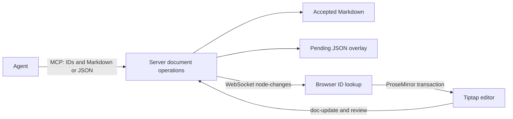

# OpenWriter: agent editing architecture

Research date: 2026-11-09. Inspected the public `main` snapshot at commit [`d95f1766fda1d894b42356af87072ec91848962f`](https://github.com/travsteward/openwriter/commit/d95f1766fda1d894b42356af87072ec91848962f). Findings are based on source inspection, not a running-instance experiment. Existing TraceX source and the separate rich-text research note were left unchanged.

## Core architecture

OpenWriter exposes document operations to an external agent over MCP. The agent reads a compact projection of a Tiptap JSON tree and sends block operations containing IDs and Markdown or JSON content. The server applies those operations to its JSON document, persists accepted content and proposals separately, and broadcasts changes over WebSocket. The browser resolves IDs against its live ProseMirror document and executes transactions. Sources: [MCP write tool](https://github.com/travsteward/openwriter/blob/d95f1766fda1d894b42356af87072ec91848962f/packages/openwriter/server/mcp.ts#L342-L435), [server application](https://github.com/travsteward/openwriter/blob/d95f1766fda1d894b42356af87072ec91848962f/packages/openwriter/server/state.ts#L1273-L1309), [WebSocket broadcast](https://github.com/travsteward/openwriter/blob/d95f1766fda1d894b42356af87072ec91848962f/packages/openwriter/server/ws.ts#L272-L314), [browser bridge](https://github.com/travsteward/openwriter/blob/d95f1766fda1d894b42356af87072ec91848962f/packages/openwriter/src/decorations/bridge.ts#L11-L179).



## Block addressing

The primary editing address is `(docId, nodeId)`. Reads expose lines such as `[p:e5f6a7b8] Text with **formatting**`, heading tags such as `[h2:a1b2c3d4]`, and indented containers. The compact projection is generated from Tiptap JSON; it is not an offset-annotated Markdown file. List items fold the first paragraph into their own line. Sources: [compact serializer](https://github.com/travsteward/openwriter/blob/d95f1766fda1d894b42356af87072ec91848962f/packages/openwriter/server/compact.ts#L23-L218).

The editor's UniqueID extension maintains an `id` attribute on the configured block node types. Its generator truncates a hyphen-free random UUID to eight hexadecimal characters. The agent does not receive or compute ProseMirror positions as part of ordinary block writes. Sources: [UniqueID configuration](https://github.com/travsteward/openwriter/blob/d95f1766fda1d894b42356af87072ec91848962f/packages/openwriter/src/editor/extensions.ts#L94-L98), [write schema](https://github.com/travsteward/openwriter/blob/d95f1766fda1d894b42356af87072ec91848962f/packages/openwriter/server/mcp.ts#L342-L355).

The important write shapes are:

```json
{
  "docId": "0123abcd",
  "changes": [
    { "operation": "rewrite", "nodeId": "e5f6a7b8", "content": "Revised **paragraph**." },
    { "operation": "insert", "afterNodeId": "e5f6a7b8", "content": "Another paragraph." },
    { "operation": "delete", "nodeId": "abcd1234" }
  ]
}
```

`afterNodeId: "end"` appends. The response contains `lastNodeId` for chaining and reports applied/skipped counts. Content strings are parsed as Markdown; Tiptap JSON is also accepted. Unresolved targets are skipped, so the batch is not an all-or-nothing transaction. Sources: [write handler](https://github.com/travsteward/openwriter/blob/d95f1766fda1d894b42356af87072ec91848962f/packages/openwriter/server/mcp.ts#L342-L435), [sequential operation engine](https://github.com/travsteward/openwriter/blob/d95f1766fda1d894b42356af87072ec91848962f/packages/openwriter/server/block-changes.ts#L148-L204).

Reads also support navigation without loading the whole document: `search_docs` finds node IDs, `outline_doc` supplies heading structure, and `peek_doc` reads selected nodes, anchor windows or ranges. Sources: [outline and peek tools](https://github.com/travsteward/openwriter/blob/d95f1766fda1d894b42356af87072ec91848962f/packages/openwriter/server/mcp.ts#L455-L501), [search tool](https://github.com/travsteward/openwriter/blob/d95f1766fda1d894b42356af87072ec91848962f/packages/openwriter/server/mcp.ts#L2065-L2082).

### Identity across Markdown round trips

The body remains Markdown. A `nodes` field in JSON-formatted frontmatter stores compact ID/fingerprint tuples, with a bounded graveyard for deleted identities. On parse and save, the matcher associates the new tree with previous identities. The adapter walks the Tiptap tree into a preorder block list with parent relationships; this block-list `position` is an ordinal, not a ProseMirror position. Sources: [serialization](https://github.com/travsteward/openwriter/blob/d95f1766fda1d894b42356af87072ec91848962f/packages/openwriter/server/markdown-serialize.ts#L77-L182), [parse matching](https://github.com/travsteward/openwriter/blob/d95f1766fda1d894b42356af87072ec91848962f/packages/openwriter/server/markdown-parse.ts#L175-L208), [tree adapter](https://github.com/travsteward/openwriter/blob/d95f1766fda1d894b42356af87072ec91848962f/packages/openwriter/server/node-blocks.ts#L1-L53).

Matching proceeds through carried known IDs, exact fingerprints, split/merge detection, type changes, shared-sentence edits, structural slot continuity, graveyard restoration, and new identity assignment. Fingerprints combine sentence hashes, type/structure and surrounding tree information. This is a deterministic identity-recovery policy; it does not prove semantic identity after arbitrary external rewrites. Sources: [matcher pipeline](https://github.com/travsteward/openwriter/blob/d95f1766fda1d894b42356af87072ec91848962f/packages/openwriter/server/node-matcher.ts#L1-L134), [carried-ID priority](https://github.com/travsteward/openwriter/blob/d95f1766fda1d894b42356af87072ec91848962f/packages/openwriter/server/node-matcher.ts#L153-L190), [fingerprints](https://github.com/travsteward/openwriter/blob/d95f1766fda1d894b42356af87072ec91848962f/packages/openwriter/server/node-fingerprint.ts#L1-L145).

When save-time matching changes an ID, `id-rewrites` is broadcast to clients, which update `attrs.id` through `setNodeMarkup`. Matching and rendering therefore converge through an explicit protocol rather than assuming that initial client IDs never change. Sources: [broadcast](https://github.com/travsteward/openwriter/blob/d95f1766fda1d894b42356af87072ec91848962f/packages/openwriter/server/ws.ts#L310-L314), [browser ID updates](https://github.com/travsteward/openwriter/blob/d95f1766fda1d894b42356af87072ec91848962f/packages/openwriter/src/decorations/bridge.ts#L181-L215).

Tables are an important boundary: identity matching treats the whole table as one opaque block, and the block write resolver refuses to descend into table internals. The compact read serializer nevertheless prints row tags and IDs. A displayed table-row ID therefore does not establish that the row is a supported stable write target. Sources: [opaque table adapter](https://github.com/travsteward/openwriter/blob/d95f1766fda1d894b42356af87072ec91848962f/packages/openwriter/server/node-blocks.ts#L188-L199), [opaque write resolver](https://github.com/travsteward/openwriter/blob/d95f1766fda1d894b42356af87072ec91848962f/packages/openwriter/server/block-changes.ts#L123-L172), [row tags](https://github.com/travsteward/openwriter/blob/d95f1766fda1d894b42356af87072ec91848962f/packages/openwriter/server/compact.ts#L107-L119).

## Mapping into ProseMirror / Tiptap

The server mutates JSON arrays with an ID lookup. The browser independently looks up `attrs.id` using `doc.descendants`, obtaining the current node and integer position. Batched changes look up each target in the evolving `tr.doc`, so earlier operations do not leave a cached stale position for later operations. It constructs native nodes with `schema.nodeFromJSON`, inserts after `pos + node.nodeSize`, and replaces or deletes native ranges. Sources: [server resolver](https://github.com/travsteward/openwriter/blob/d95f1766fda1d894b42356af87072ec91848962f/packages/openwriter/server/block-changes.ts#L148-L204), [browser batch bridge](https://github.com/travsteward/openwriter/blob/d95f1766fda1d894b42356af87072ec91848962f/packages/openwriter/src/decorations/bridge.ts#L59-L179).

For a rewrite of the same textblock type, `replaceNodeInPlace` uses ProseMirror fragment `findDiffStart` / `findDiffEnd` to replace only the changed content interval, then updates attributes. Type changes and non-textblocks fall back to whole-node replacement. This helps preserve a cursor in unchanged text; it is not a general tree diff. Source: [in-place replacement](https://github.com/travsteward/openwriter/blob/d95f1766fda1d894b42356af87072ec91848962f/packages/openwriter/src/decorations/apply.ts#L69-L100).

Partial review highlights store text offsets within a block. The decoration builder resolves them by traversing inline children from `nodeStart + 1`, accounting for text length and native node sizes; hard breaks count as one text character in the pending plugin. On document changes the plugin rebuilds decorations from attributes, rather than solely remapping a persistent DecorationSet. Source: [offset mapping and decoration rebuild](https://github.com/travsteward/openwriter/blob/d95f1766fda1d894b42356af87072ec91848962f/packages/openwriter/src/decorations/plugin.ts#L88-L239). For general API context, current Tiptap documentation confirms [native range replacement with insertContentAt](https://tiptap.dev/docs/editor/api/commands/content/insert-content-at); OpenWriter's actual behavior above is established by its source.

`edit_text` accepts exact `find` strings and optional `replace`, `addMark` and `removeMark`. Matching can span adjacent text nodes and therefore inline formatting boundaries. It uses the first `indexOf` match, with no occurrence or expected-match-count field. Edits run sequentially and unmatched edits are skipped. The resulting node goes through the regular pending rewrite pipeline. Sources: [tool schema](https://github.com/travsteward/openwriter/blob/d95f1766fda1d894b42356af87072ec91848962f/packages/openwriter/server/mcp.ts#L1514-L1539), [text matching](https://github.com/travsteward/openwriter/blob/d95f1766fda1d894b42356af87072ec91848962f/packages/openwriter/server/text-edit.ts#L29-L65), [edit loop](https://github.com/travsteward/openwriter/blob/d95f1766fda1d894b42356af87072ec91848962f/packages/openwriter/server/text-edit.ts#L271-L298), [rewrite routing](https://github.com/travsteward/openwriter/blob/d95f1766fda1d894b42356af87072ec91848962f/packages/openwriter/server/state.ts#L1372-L1408).

A concrete preservation concern in the inspected implementation: `applyTextEditsToNode` filters the input content to `type === 'text'` and installs that filtered result after a successful edit. Consequently a successful edit on a block containing `hardBreak` or another non-text inline node can remove those nodes. This follows from the code; it was not reproduced in a running instance. Source: [filter and replacement](https://github.com/travsteward/openwriter/blob/d95f1766fda1d894b42356af87072ec91848962f/packages/openwriter/server/text-edit.ts#L275-L298).

## MCP

The primary process registers tools on the MCP SDK's `McpServer` and connects `StdioServerTransport`. A second process can act as a stdio MCP proxy to the already-running local server, fetching tool definitions through `GET /api/mcp-tools` and forwarding calls through `POST /api/mcp-call`. These HTTP endpoints are an application bridge, not evidence of a standard Streamable HTTP MCP endpoint. Sources: [primary stdio server](https://github.com/travsteward/openwriter/blob/d95f1766fda1d894b42356af87072ec91848962f/packages/openwriter/server/mcp.ts#L2289-L2331), [proxy implementation](https://github.com/travsteward/openwriter/blob/d95f1766fda1d894b42356af87072ec91848962f/packages/openwriter/server/mcp-client.ts#L14-L64).

Relevant tools include document discovery and reads, `write_to_pad`, `edit_text`, `get_pad_status`, `get_comments`, and `resolve_comments`. Plugins can register additional tools and notify connected clients that the tool list changed, so a fixed tool count from the README should not be treated as the protocol contract. Sources: [tool registry](https://github.com/travsteward/openwriter/blob/d95f1766fda1d894b42356af87072ec91848962f/packages/openwriter/server/mcp.ts), [dynamic registration](https://github.com/travsteward/openwriter/blob/d95f1766fda1d894b42356af87072ec91848962f/packages/openwriter/server/mcp.ts#L2237-L2255).

## Suggestions, diff and review

There are three representations: accepted canonical content, an overlay of pending entries, and the merged live document seen by browser and MCP. Canonical content is saved to `.md`; proposals are stored at `_pending/{docId}.json`. Pending entries hold `nodeId`, `status`, proposed content, original baseline, insertion anchors, optional group/range information and editorial `feedback`. Sources: [overlay model and types](https://github.com/travsteward/openwriter/blob/d95f1766fda1d894b42356af87072ec91848962f/packages/openwriter/server/pending-overlay.ts#L1-L117), [sidecar storage](https://github.com/travsteward/openwriter/blob/d95f1766fda1d894b42356af87072ec91848962f/packages/openwriter/server/pending-overlay.ts#L158-L185).

Review uses custom `pending*` attributes plus decorations: insert, rewrite and delete have distinct styling; the original snapshot supports preview/rejection. Accepting an insertion/rewrite retains the new text and clears pending metadata; accepting deletion removes the node. Rejecting insertion removes it; rejecting rewrite restores its baseline; rejecting deletion clears its status. Group handling supports changes spanning several blocks. Sources: [schema attributes](https://github.com/travsteward/openwriter/blob/d95f1766fda1d894b42356af87072ec91848962f/packages/openwriter/src/editor/PendingAttributes.ts), [resolve operations](https://github.com/travsteward/openwriter/blob/d95f1766fda1d894b42356af87072ec91848962f/packages/openwriter/src/decorations/resolve.ts#L45-L219), [review synchronization](https://github.com/travsteward/openwriter/blob/d95f1766fda1d894b42356af87072ec91848962f/packages/openwriter/src/decorations/review-actions.ts#L109-L123).

Two different comparisons serve different purposes: the server's `computePartialRange` finds differing words, expands to sentence boundaries and can fall back to a full-block highlight; the browser's ProseMirror fragment diff minimizes the replaced interval. Neither constitutes an exhaustive change-set with independent accept/reject of every word-level hunk. `feedback` is a short editorial reason on a proposal, not a separate comment thread. Sources: [partial range algorithm](https://github.com/travsteward/openwriter/blob/d95f1766fda1d894b42356af87072ec91848962f/packages/openwriter/server/block-changes.ts#L47-L120), [minimal native replacement](https://github.com/travsteward/openwriter/blob/d95f1766fda1d894b42356af87072ec91848962f/packages/openwriter/src/decorations/apply.ts#L69-L100), [feedback schema](https://github.com/travsteward/openwriter/blob/d95f1766fda1d894b42356af87072ec91848962f/packages/openwriter/server/mcp.ts#L346-L352).

For ordinary typing inside a pending rewrite, `followUserTyping` mirrors edits outside the changed span into the original baseline, so rejection preserves those human edits. Typing inside the agent-changed span modifies the proposal only. It also adjusts highlight ranges. This handling excludes split/join steps and grouped rewrites; it is narrower than arbitrary concurrent structural merging. Source: [typing reconciliation](https://github.com/travsteward/openwriter/blob/d95f1766fda1d894b42356af87072ec91848962f/packages/openwriter/src/decorations/pending-typing.ts#L1-L181).

Review is the default, with exceptions: auto-accept commits directly, and tweet-context deletion has a direct-removal branch for paragraphs/images. Source: [delete exceptions](https://github.com/travsteward/openwriter/blob/d95f1766fda1d894b42356af87072ec91848962f/packages/openwriter/server/block-changes.ts#L410-L430).

## Comments

Comments are separate records containing `id`, selected `text`, `note`, `nodeId`, optional `nodeIds`, timestamps and optional `resolvedAt`. Storage is `_marks/{sanitized-filename}.json`, outside the editor document. The main workflow is human-selected text and a note, followed by agent `get_comments`, document edits and `resolve_comments`. Resolving archives the record with `resolvedAt`; it does not delete it. Sources: [comment shape/storage](https://github.com/travsteward/openwriter/blob/d95f1766fda1d894b42356af87072ec91848962f/packages/openwriter/server/comments.ts#L1-L90), [resolution](https://github.com/travsteward/openwriter/blob/d95f1766fda1d894b42356af87072ec91848962f/packages/openwriter/server/comments.ts#L210-L231), [MCP comment tools](https://github.com/travsteward/openwriter/blob/d95f1766fda1d894b42356af87072ec91848962f/packages/openwriter/server/mcp.ts#L1842-L1910).

Comment underlines are reconstructed by finding selected text in the identified block, or distributing selected text across `nodeIds`; unmatched comments fall back to an exact text search throughout the document. The implementation uses first substring matches. Repeated text can therefore attach to an unintended occurrence, and changed text can lose its visible anchor. This is text-and-ID reanchoring rather than a persisted ProseMirror range or collaborative relative-position anchor. Source: [comment decoration matching](https://github.com/travsteward/openwriter/blob/d95f1766fda1d894b42356af87072ec91848962f/packages/openwriter/src/decorations/comments-plugin.ts#L63-L234).

Accepting a change can automatically resolve comments that overlap/touch the modified region; rejecting keeps them open. Coverage is computed from original/proposed text, with surviving-word estimates when exact wording disappeared. This behavior is heuristic rather than proof that the author's concern was addressed. Source: [shared comment coverage](https://github.com/travsteward/openwriter/blob/d95f1766fda1d894b42356af87072ec91848962f/packages/openwriter/server/comment-coverage.ts#L1-L124).

## Concurrency and implications for TraceX

The browser sends a document version; pending entries record `addedAtVersion`. For stale browser saves the server preserves newer proposals and gives them precedence for the same node ID. A pending rewrite whose canonical baseline changed remains applied in the merged view and receives a stale flag. Missing rewrite targets become orphan insertions; missing delete targets are discarded. Sources: [browser merge](https://github.com/travsteward/openwriter/blob/d95f1766fda1d894b42356af87072ec91848962f/packages/openwriter/server/browser-state-merge.ts#L1-L18), [state sync policy](https://github.com/travsteward/openwriter/blob/d95f1766fda1d894b42356af87072ec91848962f/packages/openwriter/server/state.ts#L342-L378), [overlay reload policy](https://github.com/travsteward/openwriter/blob/d95f1766fda1d894b42356af87072ec91848962f/packages/openwriter/server/pending-overlay.ts#L21-L117).

The agent-facing `write_to_pad` schema has no expected document revision or expected old text; `edit_text` supplies an exact search string but no version or uniqueness constraint. These are pragmatic proposal-preservation mechanisms, not an atomic optimistic-concurrency contract or arbitrary ProseMirror step rebasing. The browser bridge also catches individual operation failures and continues, so a successful server mutation is not itself proof every open editor applied it. Sources: [agent write schema](https://github.com/travsteward/openwriter/blob/d95f1766fda1d894b42356af87072ec91848962f/packages/openwriter/server/mcp.ts#L342-L355), [fine edit schema](https://github.com/travsteward/openwriter/blob/d95f1766fda1d894b42356af87072ec91848962f/packages/openwriter/server/mcp.ts#L1514-L1539), [browser partial failures](https://github.com/travsteward/openwriter/blob/d95f1766fda1d894b42356af87072ec91848962f/packages/openwriter/src/decorations/bridge.ts#L65-L161).

Design inference for TraceX: the useful pattern is a compact agent projection, scoped ID-based operations, native editor execution, and a separate proposal layer. Reusing its Markdown representation, eight-character identities, fingerprint recovery or text-based comments unchanged would not establish preservation of arbitrary TraceX custom nodes, references, protected content or existing collaboration semantics. A TraceX adaptation should make editable/opaque node capabilities explicit, define stale-edit preconditions and batch failure semantics, and preserve native nodes/marks outside the target. These are recommendations derived from the limitations above, not features already implemented by OpenWriter.

No build, formatter, installation, application mutation or runtime test was run. Verification consisted of tracing the downloaded source, checking the exact commit through GitHub, and consulting current Tiptap documentation through Context7.
