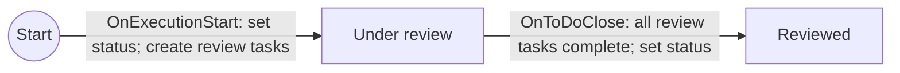
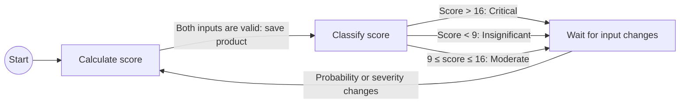

<!--
//
// Copyright © 2026 TraceX SAS.
//
// Licensed under the Eclipse Public License, Version 2.0 (the "License");
// you may not use this file except in compliance with the License. You may
// obtain a copy of the License at https://www.eclipse.org/legal/epl-2.0
//
// Unless required by applicable law or agreed to in writing, software
// distributed under the License is distributed on an "AS IS" BASIS,
// WITHOUT WARRANTIES OR CONDITIONS OF ANY KIND, either express or implied.
//
// See the License for the specific language governing permissions and
// limitations under the License.
-->

# Card types and process authoring

This is the first reference for agents creating or explaining card types and processes. It contains the document shapes, parameter contracts for common operations, expression syntax, execution rules, and worked patterns. Use these contracts directly for routine authoring; the source map at the end is for maintaining this reference, not a required tour of the codebase.

## Start here

1. Define persistent card fields, temporary results, waiting states and data dependencies before writing the graph.
2. Use v1 for concise card fields, numeric-choice calculations and the small review-task pattern. Use v2 for general actions, typed results, function composition and the complete model. Both forms compile to the same engine; they are not different execution systems.
3. For a standalone process, declare existing destination fields/entities as slots. `$slots.field` is its identity; `$card.field` reads its value. For an embedded process, specify `masterTag`, declare local fields, and use their stored names directly. Embedded module import has no standalone slot-binding dialog.
4. Publish object/group outputs with `as`; declare typed task or computation values in `results`; read either with `$context.name`. Use `expr` for transformations. Split the graph into small named states with deliberate branch/action order.
5. Check operation parameters in this guide and the workspace's exported catalog. The installed model is authoritative. Do not infer optional parameters, type constraints, task result aggregation or behavior from operation names.
6. Validate, import and exercise a newly created definition before saving into an existing process. Use the manual checks below. If required behavior is missing or unconfirmed, stop generation and identify it precisely.

| Worked definition | Purpose |
| --- | --- |
| [`risk-management.card.yaml`](./examples/risk-management.card.yaml) | Concise card fields, five numeric choices, multiplication and three risk levels |
| [`review-task.process.yaml`](./examples/review-task.process.yaml) | Concise standalone slots, task group and completion wait |
| [`approval.process.yaml`](./examples/approval.process.yaml) | General approval, locks, object outputs and named references |
| [`estimate-review.process.yaml`](./examples/estimate-review.process.yaml) | Typed task results, calculation pipeline, card writes and branching |

[`authoring-v2.schema.json`](./authoring-v2.schema.json) is the machine-readable v2 syntax contract. The v2 examples reference it with a YAML language-server directive, enabling schema-aware completion and structural diagnostics in an IDE with a YAML language server. UI validation additionally resolves the installed model, references and bindings. The schema alone cannot establish operation availability or runtime context values. The recorded work plan and verification history are in [`authoring-plan.md`](./authoring-plan.md).

## Authoring format decision: YAML

**Decision: use YAML as the authoring DSL for card types and processes.** Use declarative YAML for fields, settings, graph structure, and typed slots, with a limited expression language for calculations and conditions. Compile it to the existing native document model and execution engine. Identifiers, stored field keys, LexoRank values, and context definitions should be generated or resolved by the compiler rather than manually maintained in ordinary authoring files.

Both YAML versions are implemented in `@hcengineering/process`: `compileProcessYaml(source)` generates native documents, and `parseProcessImport(source, kind)` accepts either version or existing native JSON arrays. Both existing UI import flows accept `.yaml`, `.yml`, and `.json`. Export uses concise v1 when it can represent the complete definition; otherwise it uses the full model v2. This choice preserves every operation and property instead of dropping unsupported data or failing on a new feature.

### Complete DSL: version 2

Use v1 for the concise field/calculation/task patterns below. Use v2 for the rest of the native model, including approval, locks, subprocesses, relationships, tags, versioning, result collection, all registered functions, arbitrary native queries, field types, permissions, viewlets and dependent types. The native parameter contracts and expression reference in this same guide apply to v2. This is a representation of the existing engine, not an additional execution language.

```yaml
version: 2
kind: process
processes:
  lock_until_update:
    label: Lock until the card changes
    start:
      begin:
        to: waiting
        on: OnExecutionStart
        actions:
          lock:
            method: LockCard
    states:
      waiting:
        label: Locked
        transitions:
          changed:
            to: done
            on: OnCardUpdate
            actions:
              unlock:
                method: UnlockCard
      done:
        label: Unlocked
```

Use named blocks instead of a list of storage documents. `processes` contains each process; its `start` contains entry transitions, and its `states` contain named outgoing `transitions`. Each transition has `to`, `on` and optional named `actions`. The compiler generates `_id`, `_class`, `space`, `process`, `from` and LexoRank values. YAML declaration order defines state display order, outgoing transition priority and action execution order. Export sorts existing ranked blocks before writing them. Moving a transition in YAML changes its priority; storage ranks are never needed in ordinary authoring.

`label` maps to the process name or state title. An omitted standalone `masterTag` means the destination card type (`__MASTER_TAG__`); embedded processes must specify their owning card type explicitly. Omitted process `context` means an empty map. `on: OnExecutionStart` means an empty trigger parameter object; with parameters, use `on: {OnApproveRequestApproved: {_id: "${$context(approval_request)}"}}`. Use `method: RequestApproval`, with `params` and `context` as needed. Omitted action params become `{}`; `as` creates its result context, otherwise an omitted action context becomes `null`. An action `results` map declares named typed results; earlier explicit result arrays remain supported. Structural context/type metadata uses `id`, `class` and slot `kind`; class names such as `process.ApproveRequest`, `core.ArrOf` and `contact.mixin.Employee` expand to their native ids. To retain a custom class identity containing dots literally, use `class: {ref: custom.Type}`. Native operation parameters and queries stay unchanged, including `_id` keys and `$size` filters.

Built-in method/trigger names expand to `process:method:<name>` and `process:trigger:<name>` without a fixed operation list. Custom operations keep their fully qualified ids. New registered operations and parameters need no new exporter/compiler branches. Model lookup validates referenced methods, triggers and functions before applying; the editor performs that lookup while validating the draft too.

Card modules use the same `processes` grammar plus named `cardTypes`, `tags`, `fields`, `enums`, `views`, `roles`, `relations`, `permissions`, `attributePermissions` and `sequences`. The section implies the document class and each block name is its reference identity. Model space is implicit; a non-model `space` remains explicit. New document classes use `documents: {"plugin:class:NewClass": {named_document: {...}}}`. All additional model properties are retained. If an extension property collides with a DSL name (for example a native process property named `states`), the exporter places it under `native` on that block. This escape is for extension data, not ordinary process authoring. Earlier v2 `model` document lists remain importable but are no longer exported.

#### Named outputs and references

Ordinary actions publish their result with `as: approval_request`. No action context or process context map is needed: the compiler generates the result class, action/producer references, display index and selected-context value. The result class comes from the method model `createdContext` contract. UI validation/import use the installed workspace model; offline `compileProcessYaml(source)` uses the file catalog. `compileProcessYaml(source, model)`, `parseProcessImport(source, kind, model)` and `validateProcessYaml(source, kind, model)` accept a model explicitly. Installed contracts take precedence over catalog entries; a catalog cannot grant support for an absent method.

```yaml
request_approval:
  method: RequestApproval
  params:
    user: $card.approvers
    field: $slots.approvers
  as: approval_request
```

| Reference | Meaning | Native representation |
| --- | --- | --- |
| `$slots.approvers` | Bound field name; for entity slots, the bound model id | `__SLOT_approvers__` |
| `$card.approvers` | Current card field value; a declared attribute slot resolves its stored name | `${@__SLOT_approvers__}` |
| `$card.owner.name` | Nested current card field value | `${@owner.name}` (or the declared owner attribute slot) |
| `$context.approval_request` | A published action output | `${$context(approval_request)}` |
| `$context.approval_request._id` | A field of that output | `${$context(approval_request,_id)}` |

Use `$slots` for identities and `$card`/`$context` for values. These meanings do not change depending on parameter names. References are whole YAML string values, never interpolated inside ordinary text. Names use letters, digits, underscores and hyphens; dots separate field selectors. Unknown slots/outputs, malformed references, duplicate output declarations and mixing `as` with an explicit action context produce errors at the authoring block path. `$card` may also read actual stored card field names, such as `$card._id`; declared entity slots cannot be read as card attribute values.

Keys in params/query objects may use `$slots.field` for stored field selectors. Use `{literal: "$context.literal_text"}` when a string should remain text instead of becoming a reference. The same wrapper preserves arbitrary literal objects/arrays. Native exports escape reference-looking literal values automatically; escaped native parameter keys use `$literal:<original key>`. Native `${...}` expressions remain supported for transforms, reductions, functions, user requests and relations. The exporter uses shorthand only when decoding restores the exact original expression, so modifiers and serialized legacy contexts remain intact.

A minimal offline result contract can be supplied as:

```yaml
catalog:
  methods:
    RequestApproval:
      createdContext: {class: process.ApproveRequest}
```

Catalog method keys accept short built-in names or full method ids. Result contracts accept `class` shorthand or the original `_class` field, plus the model `nameField` for an inferred display label. Missing output contracts and methods declaring `createdContext: null` produce an explicit error for inferred outputs; the compiler never guesses a type. A known explicit output class can be given when compiling offline without that contract. This does not establish method availability: the destination model still validates the method before apply.

For exported specialized metadata, use `as: {key: approved_tag, class: $slots.approved_tag, label: Approved tag, order: 2}`. `class`, `label` and `order` are optional overrides; `order` preserves existing display order. Class hints must describe an already supported native result, not invent a method result. Additional native context metadata is retained under `as.native`; producer/action/value wiring is always generated. Unusual native context expressions, action-context extension properties and methods lacking an output contract retain their explicit context definitions. Ordinary task input/result contexts are generated from named `results` below. Unusual contexts and earlier result arrays retain their explicit metadata. The exporter removes only contexts that the shorthand can reproduce completely.

The generated `catalog` contains the actual installed method, trigger and function ids with model-defined labels, descriptions, required parameters, defaults, created context types, input/output types and related metadata. It lets an agent discover available operations in the same file. It is informational: importing a catalog never installs operations. `requiredParams` and defaults are not an exhaustive parameter schema; use the native contracts below and the exported parameters for optional behavior. If the contract for a requested behavior is absent or unconfirmed, stop generation and report exactly what is missing.

#### Typed results

An object output (`as`) identifies a created object or task group. A typed `results` map describes values produced or collected by the action. They are independent, and an action may declare both. No repeated process context map, producer/action links, indices or native result ids are needed.

```yaml
request_review:
  method: CreateToDo
  params:
    title: Provide an estimate
    user: $card.reviewers
    completionMode: any
    withRollback: true
    askRequired: true
  as: review_tasks
  results:
    effort: {label: Estimated effort, type: number}
    rate: {label: Cost per unit, type: number}
```

Wait for `OnToDoClose: {_id: $context.review_tasks}` before reading `$context.effort` or `$context.rate`. Creating the task group does not produce those input values. The native task's `completionMode: all` suppresses user results; use `any` for this pattern. Declaring results does not change a method's behavior: `SetContext` requires exactly one result; task actions collect their declared inputs through the existing completion form. The compiler does not assume that every registered method supports arbitrary results.

| Result property | Meaning |
| --- | --- |
| `type` | Required value type |
| `label` | Optional display label, defaults to the result name; an empty label is preserved |
| `field` | Optional native result `key`: an associated stored field identity, e.g. `$slots.cost`; a value reference is rejected |
| `selectionSpace`, `excludeRelation` | Existing reference-selection constraints, with the native semantics below |
| `order` | Optional nonnegative display index for preserving existing exports; ordinarily generated |
| `native` | Unknown native result extension properties; never generated identity/name/type wiring |

Readable types are `string`, `number`, `boolean`, `date`, `markup`, `{array: number}`, `{ref: contact.mixin.Employee}` and `{enum: decision_enum}`. References and arrays compose, e.g. `{array: {ref: contact.mixin.Employee}}`. The referenced enum/class must already exist or be declared in the module; these forms do not create it. The same type syntax works in fields, attribute slots and a process `resultType`. A slot with a `type` defaults to an attribute slot and `core.Attribute`: `slots: {cost: {type: number}}` is sufficient. Entity slots retain explicit `kind` and `class`. Full model types remain supported (`{class: extension.NewType, ...}`); an unusual type with colliding properties uses `{native: {_class: ..., ...}}`. No numeric range, enum-label conversion or input guard is inferred from a type name.

Generated process result metadata exactly follows native synchronization: `isResult: true`, the declared type, owning action/transition, context selector, and a shared display sequence after ordinary `as` outputs. For a reference type, its context class is the referenced class; for arrays, it follows the engine's element-type rule. Export uses named results only when it can reproduce every native property. Earlier result arrays and unusual explicit context maps remain supported.

#### Declarative expressions

Use `expr` for computations in any parameter value, including nested function properties. It assembles the existing native context expression; it executes no JavaScript.

```yaml
calculate_cost:
  method: SetContext
  params:
    value:
      expr:
        from: $context.effort
        pipe:
          - Multiply: {value: $context.rate}
  results:
    total_cost: {label: Total cost, type: number}
```

After that action, `$context.total_cost` reads the initialized result. A subsequent `UpdateCard` action with `params: {$slots.cost: $context.total_cost}` persists it on the card. An outgoing card-match transition can then branch on that field. A temporary execution result is not automatically a card field or a trigger predicate.

| Expression property | Semantics |
| --- | --- |
| `from` | Exactly one value reference (`$card`/`$context`), native context expression, or `{literal: value}` source |
| `call` | Alternative to `from`: one registered context-producing function with its properties |
| `reduce` | Native source function: reduces/processes the source object before selecting its `key` |
| `pipe` | Ordered array of registered value transforms/conversions after field selection |
| `fallback` | Literal fallback value used by the native evaluator; reference-looking strings here remain literal |

A function is either a short name with no properties, such as `NumberFromString`, or a single-entry mapping, such as `{Multiply: {value: $context.rate}}`. Custom function ids remain fully qualified. There is no per-function compiler: newly registered functions use the same grammar. The model/catalog's `type` enforces `context` for `call`, `reduce` for source reduction, and `transform` or `convert` for `pipe`. Missing installed functions and incompatible roles are errors. Input/output types and property semantics require their actual contract; role checking is not proof of complete type compatibility.

Example for numeric enum choices:

```yaml
expr:
  from: $card.probability
  pipe:
    - StringFromEnum
    - NumberFromString
    - Multiply:
        value:
          expr:
            from: $card.severity
            pipe: [StringFromEnum, NumberFromString]
```

Use a literal source for constants: `expr: {from: {literal: 5}, pipe: [{Multiply: {value: 2}}]}`. Ordinary strings are never templates. `{literal: {expr: ...}}` preserves a native object whose keys resemble expression syntax; exporters add escapes automatically. Function property expressions are resolved by that function's existing contract, not automatically by every function. Quotes, newlines and values that the text grammar cannot preserve use the engine's supported JSON context encoding internally. Canonical native expressions export as YAML pipelines; legacy/noncanonical expressions stay unchanged for exact round trips.

#### Validation boundaries

The compiler checks YAML structure, graph ownership/destinations, named references, result types, duplicate outputs, function roles and model-declared required parameters. Missing required values report their authored path; `false` and `0` are valid values. Model defaults remain suggestions and are never inserted implicitly. Semantic diagnostics include the nearest authored block's line/column. The UI also checks operation availability and destination slot bindings before writing.

The current model does **not** universally declare optional parameter schemas, conditional requirements, method result cardinality, function-property types, input validation ranges, or when a context becomes available along every graph path. A method's `objectClass` is not its parameter schema. Exported catalogs preserve future contract metadata automatically, but importing metadata does not give it execution semantics. Until those contracts exist, use the verified operation descriptions/examples and explicitly check producer-before-consumer behavior. These are limits of current model information, not reasons to invent YAML functionality.

The engine additionally has one active state per execution, ordered first-matching transitions, and a 100-step immediate-chain limit. Small named states are logical authoring blocks; they do not imply parallel branches, joins, arbitrary scripts or automatic input aggregation. A fully verified parallel/aggregation language would require an engine contract first.

For ordinary authoring, use readable symbolic ids such as `approval_process`, `waiting_for_approval`, `request_approval` and `approval_request`; references use the same names. A new standalone import generates actual graph, action, result, context and user-request ids. Standalone UI exports generate readable names for these identities and named slots automatically. Keep each state focused on one logical block, with explicit inputs, produced contexts, event/predicate, and ordered outgoing actions. Keep outgoing branches in deliberate YAML order; the compiler restores their native priority ranks.

Slots use a process `slots` map with `kind: attribute | class | association | process | unknown`, `class`, and optional `type`, `enumValues`, `label`, `name`, `memberOf`. Use `__SLOT_name__` in field keys, entity references or native context expressions. `memberOf: __SLOT_owner_type__` binds a dependency to a selected card type. The existing binding dialog supports every kind, prefills compatible bindings when editing, and clears dependent selections if their owner changes. Unknown slots accept an explicit model object id or field name; apply validates that it exists. Platform classes and their standard fields retain their native references rather than becoming workspace dependencies. Full-model slots may intentionally share a destination field.

Native expressions remain strings, for example `${@__SLOT_approvers__}`, `${$context(approval_request)}`, `${$relation(__SLOT_steps__,B,_id,Steps)=>SOURCE(All)}` and `${=>CurrentDate()}`. Updates, triggers, function modifiers and user requests use the existing engine syntax documented below. Rebinding resolves structural identities and parsed expression references, preserving literal labels, names, enum choices, constant contexts and fallback values. All context metadata and action results remain in their named blocks.

Identity behavior is explicit:

- **Standalone Create new/import:** new process, state, transition, action, result, context and user-request ids; destination owner is the selected card type. Enum dependency documents retain native identities, as in JSON.
- **Save current process:** retain the selected process id, owner and rank; replace its graph and complete definition in the existing apply transaction, removing obsolete properties and graph documents. Active executions are not migrated or inspected.
- **Full card module file import:** retain native ids and use existing JSON import/update behavior, including attached documents and workspace sequences.
- **Card editor Create new:** copy the complete module with fresh document and graph identities, rebinding its dependent classes, enums, associations, viewlets, roles, sequences and contexts. Existing types are not overwritten.

[`approval.process.yaml`](./examples/approval.process.yaml) is a small complete DSL example: bind Approvers to an employee array and Approved to a tag applicable to the destination card. The graph requests approval and locks the card, waits for the approval request context, adds the tag on approval, and unlocks on rejection. It uses named references and three focused states. The workspace approval export can additionally retain section locks, task results, cancellation and nested subprocesses without changing this format.

### Two packaging modes

| Mode | Owns | Dependencies and native output |
| --- | --- | --- |
| Card module | Card type, its fields/enums, and named embedded processes | References resolve against the module's declared fields. Field calculations generate an additional process that starts automatically. Produces a native card module with concrete ids. |
| Standalone process template | A reusable process graph or calculations and typed attribute slots | The destination card type and fields already exist. Supply all field bindings through the existing import dialog. Produces a portable native process export with `requiredSlots` and placeholders. Class, association, and process slots are outside v1. |

Both modes must share one process definition grammar and the same operation and expression semantics. Embedding a process in a card should provide its field bindings, not introduce a separate process language. A standalone template must not secretly create or depend on an undeclared card type or field.

Minimal executable card module:

```yaml
version: 1
kind: card
card:
  key: risk
  label: Risk management
  fields:
    probability:
      choice: [1, 2, 3, 4, 5]
      default: 1
      required: true
    score:
      type: number
      calculate: number(probability) * 5
```

Minimal executable standalone template:

```yaml
version: 1
kind: process
process:
  key: mark-reviewed
  label: Mark reviewed
  slots:
    status:
      kind: attribute
      type: string
  start:
    to: reviewed
    actions:
      - update:
          status: Reviewed
  states:
    reviewed: {}
```

Symbolic keys identify fields, states, task contexts, and slots within the authoring document. Display labels are separate. Field/slot keys use letters, digits, and underscores and start with a letter; other symbolic keys may also contain hyphens. Attribute bindings resolve to `Attribute.name`, not its document id. The importer checks actual destination field types; choice slots require the same choice set, regardless of enum id or order. Each slot must bind to a different field, so an output cannot unexpectedly overwrite an input through another slot. Missing, incompatible, or duplicate bindings are explicit errors.

The implemented pipeline is independent `js-yaml` parsing, property/value checks, semantic validation, and native document generation. V1 imports create fresh native ids; `card.key` and `process.key` are authoring names, not update identities. Standalone v2 imports also generate fresh graph/action/result ids. V2 card module file imports retain their document identities like JSON; the editor's Create new action clones the module with fresh identities and consistent field references. The process editor also offers Save current process: its selected process id, owner, and rank are preserved while states, transitions, actions, and task contexts are replaced. Native JSON imports retain their existing identity/update behavior.

### Implemented v1 contract

The root contains `version: 1`, `kind: card | process`, and the matching `card` or `process` object. Unknown properties are errors. YAML tags that create non-JSON objects, multiple documents, cyclic aliases, and excessively deep nesting are rejected. Files are limited to 1 MiB.

For `card`, require `key`, `label`, and a `fields` mapping (which may be empty); optionally supply `description`, `icon`, `color`, `background`, and `processes`, a mapping from process names to definitions. Embedded processes reference the card's fields directly and cannot declare slots.

Field definitions have the following properties:

| Property | Supported values and behavior |
| --- | --- |
| `label` | Optional display text; defaults to the symbolic key. |
| `type` | `string`, `number`, or `employee`. Use `choice` instead of `type` for an enum. |
| `choice` | Nonempty unique array of strings or finite numbers. Native enum values are strings; numeric defaults and updates are converted accordingly. Raw `${...}` context syntax is rejected in choice values. |
| `enumKey`, `enumName` | Card choices only: optional shared enum key and display name. Fields sharing a key must declare identical values and names. |
| `multiple` | Boolean, default `false`; only employee fields may be arrays in v1. |
| `default` | Card fields only: a string, finite number, or declared choice matching the field type. Employee defaults are unsupported. |
| `required` | Card fields only: boolean, default `false`. |
| `readonly` | Card fields only: boolean, default `false` unless calculated. Generates both `readonly` and `automationOnly`. |
| `calculate` | Card fields only: an expression or conditional cases. Calculated fields must be scalar and readonly, and cannot have defaults. |

A standalone process requires a `slots` mapping; use `slots: {}` when no fields are referenced. Each slot requires `kind: attribute` and uses `label`, `type` or `choice`, and optional `multiple` from the table. Slots describe existing field types; they cannot declare defaults, required/readonly settings, or field calculations. Configure editing restrictions on the destination fields themselves.

Both embedded and standalone v1 processes accept `label` (required), optional `key`, `description`, `autoStart` (default `false`), and `showInHeader` (default `true`). `parallelExecutionForbidden` defaults to `true`; set it explicitly to preserve other execution settings. Optional `automationOnly` is a boolean. Choose exactly one form:

- **Calculations:** `calculations` maps output field/slot keys to expressions or cases. Include all input and output fields in the card or slots. Do not also declare `start` or `states`.
- **Explicit graph:** `start: {to, actions?}` and nonempty `states`. Each state accepts optional `label` and `transitions`; each transition requires `on`, `to`, and optional `actions`. A state with no outgoing transitions finishes the execution. Actions execute in list order.

In card modules, field-level `calculate` declarations automatically create the `Recalculate fields` process with `autoStart: true`. Explicit named processes are additional processes; they do not replace the generated calculations.

#### Calculations and conditions

Supported expressions are a scalar field reference, a decimal numeric literal, `number(field)`, and multiplication with `*`, for example `number(probability) * number(severity)`. Expressions are compiled to native transforms without evaluating JavaScript. Output and expression types must match. Copying a choice field requires output choices that cover every input choice.

`number()` accepts number fields and choices whose values are finite decimal numeric strings. It does not map descriptive enum labels to scores or parse arbitrary string fields. Addition, division, parentheses, scripts, function calls other than `number()`, and raw `${...}` expressions are unsupported in v1. Native expression operands must remain decimal when serialized by JavaScript; values that turn into exponent notation (for example `0.0000001` or `1000000000000000000000`) are rejected because the native decoder would otherwise change their type. This restriction applies to encoded expression operands, not ordinary numeric field values or literal updates.

Conditional calculations use ordered `cases`, each with `when` and literal `value`, plus required `otherwise`. Conditions compare one number field to a decimal number with `>`, `<`, `>=`, `<=`, or `==`. The first matching case wins. The risk example uses `score > 16`, then `score < 9`, then `otherwise: Moderate`, so both 9 and 16 are Moderate.

Dependencies are sorted before graph generation; unknown fields and dependency cycles are errors. At least one external input is required. The generated process validates inputs, calculates outputs in order, and waits for input changes. Changes to calculated fields do not start another pass. Missing/null inputs or undeclared input choices pause calculation until valid values are present; existing outputs retain their last computed values during that pause.

#### Explicit triggers and actions

| YAML | Native behavior |
| --- | --- |
| `on: {changed: probability}` | `WhenFieldChanges` for the declared field/slot. |
| `on: {matches: "score > 16"}` | Automatic `OnCardUpdate` card predicate. This can execute immediately on entering a state whose predicate already matches. |
| `on: {matches: {score: {gte: 9, lte: 16}}}` | A conjunction of typed field predicates. Supported operators: `exists` (boolean), `ne`, `in` (array), and numeric `gt`, `gte`, `lt`, `lte`. A scalar value is equality; `null` is allowed. Employee fields support presence/null checks. `matches: {}` is unconditional. |
| `on: {tasksCompleted: review-tasks}` | `OnToDoClose` waiting for the task group published by the named task action. |
| `- update: {status: Reviewed}` | `UpdateCard` with nonempty literal updates validated against declared fields. A value can also be `{calculate: "number(probability) * number(severity)"}`; this preserves the original action boundary and update order. |
| `- task: {key: review-tasks, title: Review card, users: reviewers, completion: all, rollback: true}` | `CreateToDo` publishing a named task group context. `users` references an employee field/slot, scalar or array. `completion` must explicitly be `all` or `any`; `rollback` must explicitly be boolean. |

Task titles are literal text. Optional `contextLabel` preserves a task group context name distinct from the task title. Declare a task producer before its consumers in the file: start actions are compiled first, then states and their transitions in mapping/list order. The producer must execute on every path reaching a task completion transition. Unknown destinations, unreachable states, and cycles consisting only of automatic match transitions are rejected. Do not encode event-driven waiting as an automatic cycle.

Other native operations described later in this guide are not automatically supported by YAML v1. Unknown operations are errors; extending the compiler requires an explicit, verified contract.

### Examples and manual import

- [`risk-management.card.yaml`](./examples/risk-management.card.yaml): full risk card, probability/severity choices 1–5, numeric product, and three risk levels. In card type settings, use the existing module import and select this YAML file. Create a card of the imported type; check 5×5 → Critical, 3×3 → Moderate, 1×5 → Insignificant, and change both inputs to verify recalculation.
- [`review-task.process.yaml`](./examples/review-task.process.yaml): standalone review process. On an existing card type, use the process section's import, select the YAML file, and bind Reviewers to an employee array field and Status to a string field. Supply reviewers on a card, start the process, and complete all review tasks; status changes from Under review to Reviewed.
- For a standalone risk calculator, move the card's calculation declarations to `process.calculations`, declare all four fields as typed attribute slots, and omit card-only settings. Bind inputs and outputs to existing fields during import. Set `autoStart: true` if this process should start automatically.

Keep the native JSON examples below for inspecting generated model shapes and exchanging updates to existing definitions. YAML and Unified Format workspace imports are separate formats.

### Export and UI editor usage

- **Card types:** The type settings export menu offers JSON and YAML. The YAML editor button in the type list starts a new module; the button beside a type's export opens its supported definition as a draft for a new type.
- **Processes:** The export menu offers JSON with slots, JSON without slots, and YAML DSL. The process section's YAML editor button starts a new standalone draft. The button in an existing process opens its supported definition with detected field bindings.
- **Editing:** The dialog uses a monospace text area with two-space Tab insertion. It validates YAML syntax and the complete DSL contract on each change. Parser errors include line/column; semantic errors identify the property path and the location of its nearest authored block. Invalid drafts cannot be applied, but can be downloaded for later editing. Open YAML file replaces the draft.
- **Applying:** Create new definition routes through the existing card or process import flow. Processes request slot bindings. Save current process is available when opened from a process; it updates that process and replaces its graph in one apply operation. The slot dialog prefills previously detected bindings; changed slots can be rebound. Cancelling it keeps the draft open. Saving does not inspect or migrate active executions.
- **Coverage:** YAML export uses concise v1 for its documented field types, updates/calculations, tasks and triggers. Other operations, contexts, metadata, permissions, relations, inheritance, dependent types and localized labels are retained in full model v2. Standalone full exports include readable graph identities, typed entity slots and the installed operation catalog. The editor validates either version. Nothing is silently omitted.

Manual verification:

1. Export a supported risk module and review process in both formats; verify extensions and that old JSON imports still work.
2. Open the YAML editor, introduce broken indentation or an unknown property/field, and check the visible diagnostic and disabled apply buttons. Fix it, download the draft, reopen it, and import it with field bindings.
3. Open an existing review process, change its label and task title, and save the current process. Verify the process id stays the same, the new graph is shown, and obsolete states/transitions are gone. Then create a new definition from the same editor and verify it appears as a separate process.
4. Run newly saved/imported review and risk processes on cards. For risk, check 5×5 → Critical, 3×3 and 4×4 → Moderate, 1×5 → Insignificant, and recalculation after changing either input.
5. Export an approval process or a module with permissions/relations as YAML; verify it uses `version: 2`, retains every native operation/property, and includes the catalog. Open the process in the YAML editor, change a task title, save it and verify its id remains unchanged. Bind every dependency when importing a new process. Change a method id to one absent from the installed model and check that the editor reports the missing operation and blocks apply.
6. Open `estimate-review.process.yaml`. Bind `reviewers` to an employee-array field, `cost` to a number field and `status` to a string field. Give the test card at least one reviewer, run the new process and complete one task with effort `10` and rate `10`: expect cost `100`, status `Accepted`. On another execution, use `10` and `10.1`: expect cost `101`, status `Needs approval`. Confirm task inputs and `total_cost` appear as typed outputs in the visual editor. Change `pipe` to a string or remove `SetContext.params.value`: expect a diagnostic and disabled apply. Then save a renamed version into the current process and check its identity is retained.

### Existing YAML support and reuse

The repository already has a Unified Format YAML importer. V1 reuses `js-yaml` independently; it keeps its own strict contract and does not apply Unified Format variable substitution. These references record the comparison:

| Existing implementation | Confirmed behavior |
| --- | --- |
| [`packages/importer/src/huly/cards.ts`](../../../packages/importer/src/huly/cards.ts) | Imports YAML definitions for master tags, tags, enums, and associations; creates custom attributes from `properties`. |
| [`packages/importer/src/huly/schema.ts`](../../../packages/importer/src/huly/schema.ts), [`validation.ts`](../../../packages/importer/src/huly/validation.ts) | Custom configuration schemas and validation for these definitions. Existing keys include `class`, `title`, `properties`, `enumOf`, `refTo`, and `isArray`. |
| [`packages/importer/src/huly/parser.ts`](../../../packages/importer/src/huly/parser.ts) | Uses `js-yaml`; reads YAML files and Markdown frontmatter and substitutes configured variables. |
| [`dev/import-tool/docs/huly/README.md`](../../../dev/import-tool/docs/huly/README.md), [`example-workspace`](../../../dev/import-tool/docs/huly/example-workspace) | Documentation and existing YAML examples for workspace objects and custom card types. |

These references establish existing YAML parsing, card type import, and custom configuration patterns. The inspected card schemas do not define process graphs or typed process slots, so they do not establish support for the new DSL.

Reuse the existing format or infrastructure where its semantics naturally fit the new authoring model. Compatibility is optional, not a design constraint: do not distort the new DSL or add adapters solely to force reuse. If the existing format does not fit, define a separate format and reuse only suitable pieces, such as YAML parsing or validation patterns. Keep format detection explicit so an existing file is not accidentally interpreted as a new DSL document.

The Unified Format parser substitutes `${...}` variables, which overlaps native process expression syntax. Assess that behavior before reusing the parser; YAML parsing can be reused independently of variable substitution.

## Prefer small, readable process blocks

Split a process into small, named logical blocks with one business responsibility each. Each block should be understandable from its name, inputs, ordered actions, output changes or contexts, and its waiting or completion condition.

- Use names such as `Calculate score`, `Classify score`, and `Wait for input changes` instead of anonymous numbered phases.
- Keep related actions together, especially when later actions depend on earlier card writes or output contexts. Preserve transaction boundaries and execution semantics when reorganizing an existing process.
- Show the trigger and outgoing destinations explicitly. Keep branching predicates simple and mutually exclusive where possible.
- Make dependencies between blocks explicit: persistent card fields, published execution contexts, and external slots. Check that a producer executes before every consumer.
- Separate unrelated responsibilities such as calculation, review tasks, and notifications; avoid one large transition that conceals several business phases.
- Use the smallest graph that communicates the behavior. Do not introduce a state for every trivial assignment or split a calculation into multiple processes solely to make it shorter.

A logical block is an authoring and readability concept, represented by existing states and cohesive transitions. It does not imply a new runtime entity or an automatic subprocess call. Use a real subprocess only when separate execution or reuse is needed and its parameter/result contract is verified. The risk example demonstrates three readable blocks within one active process; the review example separates task creation from waiting for completion.

## Process generation rule: stop on missing functionality

This rule applies only when generating process definitions or templates. It does not restrict general development work.

During process generation, if required functionality appears to be missing or its support is not confirmed, **stop generation and report exactly what is missing and which requested process behavior depends on it**. Identify the missing action, trigger, transform, API, parameter contract, or workspace definition. Do not invent an identifier, parameter, expression, operation, or implicit engine behavior; do not silently substitute a workaround or extend the engine. Wait for the user's direction before continuing generation.

For example: “The enum labels contain descriptions, but this guide does not define a supported label-to-number mapping operation. Numeric conversion alone cannot implement the requested calculation. A verified mapping operation or numeric enum values are needed.”

An absent workspace export is a missing input, not evidence that the engine lacks a feature. State that distinction explicitly. Keep generated files, labels, descriptions, enum values, and examples in English.

TraceX processes are graphs attached to card types or tag mixins. A transition combines a trigger, a destination state, and an ordered list of actions. To build a process from a business description, first define the card data, then the waiting states, events, actions, and data dependencies between actions.

For an existing workspace process, start from its exported JSON and the corresponding card type or module export. Source code defines the engine and available operations; the workspace model contains the actual configured process definitions.

Use the parameter contracts below rather than inferring parameters from UI labels or method names. The method catalog is not a complete schema: for example, `UpdateCard` declares no required parameter names, but its server implementation rejects an empty parameter object.

## Card data comes first

A `MasterTag` is a dynamic class extending `card.class.Card` or another master tag. A `Tag` is a mixin adding a separate set of fields. A card's `_class` identifies its master tag; applied tag mixins provide additional sections and attributes.

Custom fields are `core.class.Attribute` documents in `core.space.Model`:

| Attribute property | Meaning |
| --- | --- |
| `attributeOf` | Owning master tag or tag mixin |
| `name` | Stored property key used in action parameters and DSL expressions |
| `_id` | Attribute document identifier; distinct from `name` |
| `label` | Display label, typically produced with `getEmbeddedLabel` |
| `type` | Native property type such as `TypeString`, `EnumOf`, `RefTo`, or `ArrOf` |
| `required` | Whether the field is required |
| `automationOnly` and `readonly` | Editing restrictions used by custom field creation |
| `rank` | Display order |

The UI generates field names as `custom` plus a generated id. A label such as “Reviewers” is not the stored field name. Bind an attribute slot to `attribute.name`, not `attribute._id`.

Before designing transitions, specify the business fields, types, cardinality, allowed values, and owners. Decide whether each value is persistent card data or a temporary execution result. A process state does not automatically change a card's status field; use `UpdateCard` when a visible business status must be updated.

Card spaces have a `types` restriction. Check both the target type and the relevant creation path when adapting a type to a space; space handling may differ between UI, form, and agent tools.

A full card module export includes its type, attributes, permissions, relationships, referenced types, and export extensions such as processes. A process-only export expects a compatible destination type and its fields to already exist.

## Native document and field shapes

The import artifact is a JSON array of documents. Every definition has `_id`, `_class`, and `space: "core:space:Model"`. Omit runtime metadata such as `createdOn`, `modifiedOn`, `createdBy`, and `modifiedBy`.

| Document class id | Definition properties |
| --- | --- |
| `card:class:MasterTag` | `extends`: parent class id, normally `card:class:Card`; `kind: 0`; `label`: embedded label; `icon: "card:icon:MasterTag"`; optional `description`, `background` |
| `card:class:Tag` | Mixin type: `extends`: target class id; `kind: 2`; `label`: embedded label; `icon: "card:icon:Tag"`; optional `rank`, `description` |
| `core:class:Enum` | `name`: display name; `enumValues`: array of allowed strings |
| `core:class:Attribute` | `attributeOf`: owning type id; `name`: stored key; `label`: embedded label; `type`: native type object; custom fields use `isCustom: true`; optional `required`, `readonly`, `automationOnly`, `defaultValue`, `rank` |
| `process:class:Process` | `masterTag`, `rank`, `name`, `description`, `context`; optional `autoStart`, `showInHeader`, `automationOnly`, `parallelExecutionForbidden`, `requiredSlots`, `bindings`, `resultType` |
| `process:class:State` | `process`: process id; `title`: display title; `rank` |
| `process:class:Transition` | `process`: process id; `from`: state id or `null`; `to`: state id; `trigger`: trigger id; `triggerParams`: object; `actions`: ordered array of steps; `rank` |

Embedded labels have the form `embedded:embedded:Probability`, produced by `getEmbeddedLabel('Probability')`. Enum choices and process/state names are ordinary strings. A new custom field name conventionally uses `custom` plus a generated id. Generate fresh ids for new definitions; use exported ids when updating existing definitions. A reference to an existing workspace object must come from that workspace, not from an invented name.

The following are complete native `Attribute.type` objects; replace the example enum and referenced type ids with the corresponding definition ids:

| Value | Type object |
| --- | --- |
| String | `{"_class":"core:class:TypeString","label":"core:string:String"}` |
| Number | `{"_class":"core:class:TypeNumber","label":"core:string:Number"}` |
| Enum choice | `{"_class":"core:class:EnumOf","label":"core:string:Enum","of":"enumId"}` |
| Employee reference | `{"_class":"core:class:RefTo","label":"core:string:Ref","to":"contact:mixin:Employee"}` |
| Array of employee references | `{"_class":"core:class:ArrOf","label":"core:string:Array","of":{"_class":"core:class:RefTo","label":"core:string:Ref","to":"contact:mixin:Employee"}}` |

For an automation-only field, use both `readonly: true` and `automationOnly: true`. For editable enum input, set `defaultValue` to an allowed enum string, not a number. Declare each enum document once and let multiple fields reference it.

### Steps and output definitions

A step is an object embedded in `Transition.actions`, not a separate model document:

```json
{
  "_id": "__ACTION_0__",
  "methodId": "process:method:UpdateCard",
  "context": null,
  "params": {
    "__SLOT_status__": "Under review"
  }
}
```

`context` is `null` when the action does not publish an object/group output. An action that publishes an output uses `context: {"_id":"__CONTEXT_0__"}`. Optional `results` contains typed values or user inputs, each shaped as `{"_id":"resultId","name":"Result name","type":nativeType}` with an optional `key` for the associated object field.

For every published object/group output, `Process.context` contains a definition like this:

```json
{
  "__CONTEXT_0__": {
    "name": "Review tasks",
    "_class": "process:class:ProcessToDo",
    "action": "__ACTION_1__",
    "index": 1,
    "producer": "__TRANSITION_0__",
    "value": {
      "type": "context",
      "id": "__CONTEXT_0__",
      "key": ""
    }
  }
}
```

`index` is the display sequence of published contexts; `syncContext` assigns it starting at 1 across the process outputs. It is not an action array index. A typed scalar result additionally declares `isResult: true` and `type` in its context definition; its `_class` is the value type's class. The result identifier comes from `Step.results`, not from the step's own `_id`. A process with only card writes uses `context: {}`.

### Ordering

Ranks are ordered LexoRank strings. `0|400000:`, `0|800000:`, `0|c00000:`, `0|g00000:`, `0|k00000:`, `0|o00000:`, and `0|s00000:` are a valid ascending sequence for a small new example. Generate more ranks with `makeRank` or `genRanks`; preserve existing ordering when editing an export.

## Definition and execution are separate

| Entity | Role | Main links |
| --- | --- | --- |
| `Process` | Reusable definition and settings | `masterTag`, `context`, optional `resultType`, `bindings` |
| `State` | A point where execution can wait or finish | `process`, `title`, `rank` |
| `Transition` | Event or condition plus actions moving execution | `process`, `from`, `to`, `trigger`, `triggerParams`, `actions` |
| `Step` | One action embedded in a transition | `_id`, `methodId`, `params`, `context`, optional `results` |
| `Execution` | One running instance for a card | `process`, `card`, `currentState`, `status`, `context`, `rollback` |
| `ExecutionLog` | History of started, transition, or rollback events | `execution`, `transition`, `action` |

Definitions are stored in the model. Runtime executions and tasks are separate documents. Generating a definition does not require generating an `Execution` document.

`Process.context` describes output names, types, and producing actions/transitions. `Execution.context` holds the values for a particular run. The server's `syncContext` synchronizes the definitions from `Step.context` and `Step.results`.

`Process.autoStart` controls automatic creation of executions for applicable card/version events. `Trigger.auto` controls automatic checking of outgoing transitions after a transition executes. These flags have different purposes. `showInHeader`, `automationOnly`, and `parallelExecutionForbidden` control exposure and execution restrictions; they do not define the graph.

## Execution rules that affect the graph

1. A starting transition uses `from: null`. The editor initially creates an `OnExecutionStart` transition. Standard process design should use one clear starting transition: execution creation currently takes the first transition with `from: null`.
2. For normal event handling, `findTransitions` selects transitions for the event and current state, ordered by `rank`. `pickTransition` returns the first whose server check passes. Overlapping conditions therefore need deliberate priority or mutually exclusive predicates.
3. Actions run in their array order on the chosen transition. They are not executed merely because a state exists.
4. Action output contexts become available as actions run. Card updates are reflected in the transition's card cache, so later actions can read the updated values.
5. The collected transition transactions are applied with a match on the execution's current state. On success, the engine updates the state, context, rollback history, and execution log.
6. A destination with no outgoing transitions for that process sets `Execution.status` to `Done`. Naming a state “Done” has no execution semantics.
7. `checkNext` checks outgoing transitions whose triggers have `auto: true`. A matching transition can execute immediately; a state intended for waiting needs a condition that remains false until the required event or data arrives.
8. Immediate transition chains have a depth limit of 100. Avoid automatic cycles that never reach a wait.
9. A failed action records an execution error and stops the transition. Rollback depends on the selected methods and trigger implementation; do not assume every external side effect can be reversed.

Use native LexoRank strings from `makeRank` or `genRanks` when generating documents. `rank` is not an arbitrary sequence number.

## Common operation contracts

These contracts cover card calculations, field updates, task completion, and typed execution values. They are not a claim that every platform operation is documented here. If the requested behavior needs an operation or parameter contract not covered here or by a supplied known example, apply the primary rule and report the gap.

### Actions

Use the exact `methodId` shown below. `params` values can be literals or native context expressions.

| Method id | Parameters | Output and requirements |
| --- | --- | --- |
| `process:method:UpdateCard` | Nonempty object mapping stored attribute names to new values | Writes the current card. `context: null`. Attribute slots resolve to field names. Declare visible business status updates explicitly. |
| `process:method:CreateToDo` | Required `title`, `user`; explicitly set `completionMode: "all"` or `"any"` and `withRollback`; optional `description`, `dueDate`, `field`, `askRequired` | `user` is an employee reference or an array of them. Empty recipients are an error. Publishes a task group under `Step.context._id`. In `all` mode, user results and `askRequired` are suppressed. |
| `process:method:SetContext` | Required `value`; the step must declare exactly one typed entry in `results` | Initializes that result in execution context. Use `context: null`. Read it with `${$context(resultId)}` after this action. |
| `process:method:UpdateContext` | Required `contextId`: literal result id, and `value` | Updates an already initialized result whose context definition has `isResult: true` and a `type`. It does not create a definition or write a card field. |

Task parameters do not inherit the method catalog's defaults when raw JSON is executed. The catalog suggests `completionMode: "all"` and `withRollback: true`; the raw server fallback is `"any"` and `false`. Set both explicitly.

### Triggers

Use the exact `trigger` id shown below. `auto` and `init` are properties of the catalog trigger, not properties to add to a transition.

| Trigger id | Init / auto | `triggerParams` and semantics |
| --- | --- | --- |
| `process:trigger:OnExecutionStart` | `init: true`; no automatic outgoing check | `{}` on the starting transition with `from: null` |
| `process:trigger:WhenFieldChanges` | `init: false`, `auto: false` | One stored field key mapped to a match condition, for example `{"customProbability":{"$exists":true}}`. Fires only when that field is present in the update operations and its condition matches. Only the first parameter key is checked; use separate transitions for separate input fields. |
| `process:trigger:OnCardUpdate` | `init: false`, `auto: true` | Card match query, for example `{"customScore":{"$gt":16}}`. Checked on card update events and immediately after a transition. Multiple field predicates in the same object are combined with AND. An empty query matches unconditionally. |
| `process:trigger:OnToDoClose` | `init: false`, `auto: true` | Required `_id`, normally `"${$context(taskContextId)}"`; waits for the task/group produced by the task action. Completion follows the group's explicit `all` / `any` mode. |

Match conditions include direct equality and `$gt`, `$lt`, `$gte`, `$lte`, `$in`, and `$exists`. For a bounded range, use both bounds in one field predicate: `{"customScore":{"$gte":9,"$lte":16}}`. Top-level `$or` is not supported by platform document queries; model alternatives with separate transitions and deliberate priority.

### Value functions

Functions appear in an expression chain as `=>Name(props)`. Their full ids are `process:function:Name`.

| Function id | Input / output | Properties and semantics |
| --- | --- | --- |
| `process:function:StringFromEnum` | Enum string → string | No properties. Null or missing values become an empty string. |
| `process:function:NumberFromString` | String → number | No properties. Uses numeric conversion; an empty string becomes zero and descriptive text can become `NaN`. Validate inputs first. |
| `process:function:EnumFromString` | String → enum string | No properties. Does not translate descriptions or validate enum membership. |
| `process:function:Multiply` | Number → number | Required `value`: numeric literal or a context expression resolving to a number. Multiplies the incoming number by it. A nonnumeric right operand leaves the incoming value unchanged; validate conversion and input types. |
| `process:function:ArrayLength` | Array → number | No properties. Counts array elements; a missing or empty array gives zero. |

For the risk calculation, with illustrative stored field keys `customProbability` and `customSeverity`:

```text
${@customProbability=>StringFromEnum()=>NumberFromString()=>Multiply(value="${@customSeverity=>StringFromEnum()=>NumberFromString()}")}
```

Replace these keys with the actual `Attribute.name` values. Guard both fields with `$in: ["1", "2", "3", "4", "5"]` before evaluating this expression. Pass the whole expression as the `UpdateCard` value for the numeric score field. Save the score, then classify it in mutually exclusive branches.

## Data flow and context expressions

Use the native expressions described here and, when writing TypeScript, prefer `createContext` over manually assembling expression strings. The separate [DSL reference](dsl.md) provides parser details when maintaining the format.

| Expression | Meaning |
| --- | --- |
| `${@customFieldName}` | Read a field from the current card |
| `${@referenceField.title}` | Follow a reference field and read a target field |
| `${$context(contextId)}` | Read a previously produced execution value |
| `${$context(contextId,title)}` | Read an output object's field when supported by its context definition |
| `${$userRequest(resultId,value,classId)}` | Read a user-provided value using the expected result/class identifiers |
| `${@customFieldName=>FALLBACK("default")}` | Provide a fallback for a process error while resolving the value |

A context reference uses `Step.context._id` or `UserResult._id`, not `Step._id`. Runtime values can be object ids, task group ids, arrays, or typed results. Use the output shape of the selected method; a group id is not a list of assignee ids.

`CreateToDo` returns a task group context. `OnToDoClose.triggerParams._id` should reference that context to wait for the correct task group. With `completionMode: "all"`, all tasks in the group must finish; the implementation suppresses task input results and `askRequired`. With `"any"`, at least one task must finish and result conditions can be checked. Specify the mode explicitly when authoring raw JSON: the catalog defaults and raw runtime fallback differ.

Typed temporary values can be declared with `SetContext` and its `Step.results`. `UpdateContext` updates an already initialized result via `contextId`; it is not a replacement for `UpdateCard`.

`getContextValue` resolves an expression as a value. Do not assume JavaScript template interpolation such as `"Review ${@title}"`, or recursive evaluation of expressions inside literal arrays. The resolver recursively handles object values but leaves literal arrays unchanged. If a requested composition needs a transform whose behavior is not established here or in a supplied example, stop and report that missing contract.

## Reading an existing process

Start with an export from the process editor, preferably with slots when the goal is reuse. Use the card module export when fields, relationships, or referenced types also need to be understood.

Read it in this order:

1. Identify the `Process`, its `masterTag`, startup settings, and required slots.
2. Build a table of states by `_id`. Find the starting transition and terminal destinations.
3. Group transitions by `from`, then sort them by `rank`. Translate each trigger into a business event or condition using its server check.
4. Read each action in order. Resolve its method, parameters, card writes, side effects, and output context.
5. Trace every `$context(...)` and user result back to its producer. Check that it exists before use on every relevant path, including retry and rejection loops.
6. Resolve field, class, association, and subprocess bindings against the destination type and its related model objects.
7. Summarize each transition as “when X happens in state Y, do A and B, then move to Z”.

An explanation should include the graph, field definitions, transition/action table, output dependencies, and any unresolved bindings. Distinguish a missing workspace export from missing engine documentation: the repository cannot identify a user's configured processes by their display names alone.

## Building a new process from a business request

Write a short business specification first: target card type, fields, participants, start condition, success condition, alternative outcomes, and persistent changes. Ask for missing business decisions when they affect the graph; keep technical ids out of that conversation.

Produce these reviewable parts:

- A card field table with types, cardinality, required values, and editing rules.
- A state diagram showing where the process waits and where it finishes.
- A transition table containing source, trigger and parameters, ordered actions, destination, and priority.
- A dependency table mapping each execution context to its producer, value type, and consumers.
- A native process template or module export plus the required bindings.

Then map the specification to existing methods and triggers. For an approval process, pair `RequestApproval` with `OnApproveRequestApproved` and `OnApproveRequestRejected`, and decide explicitly what rejection changes and whether it loops. For a task process, pair `CreateToDo` with `OnToDoClose`. For a manual action, pair `CreateAction` with `OnEvent` using the same `eventType`. For subprocesses, inspect `RunSubProcess`, the child process result type, and the appropriate completion/matching trigger.

Use the operation contracts above for required values, result shapes, and participant formats. Reuse a known exported pattern when available instead of inferring its JSON from UI labels. The approval, manual action, and subprocess pairs name existing platform patterns but do not provide their complete parameter contracts here; if one is needed without a supplied verified example, stop and report the exact missing contract.

## Portable templates and card modules

The process editor serializes `exportProcess(...).docs`: the import input is a JSON array of documents, not the enclosing `{ docs, required }` result.

Portable process exports use placeholders such as `__PROCESS__`, `__MASTER_TAG__`, `__STATE_0__`, `__TRANSITION_0__`, `__ACTION_0__`, and `__CONTEXT_0__`. Slot placeholders are `__SLOT_name__`.

`requiredSlots` describes required attributes, classes, associations, and other processes. `bindings` maps slot names to concrete values. Attribute bindings use stored field names; class, association, and process bindings use model ids.

`importProcess` generates fresh internal ids, substitutes the target master tag and slot bindings, removes `requiredSlots` from the imported process, and creates or updates model documents. Supply every required binding: unresolved placeholders are currently assigned generated ids, which can hide a missing dependency until execution. Re-importing a portable template normally creates another process because `__PROCESS__` receives a fresh id.

Card module import follows `importModule`, which uses the exported document ids and does not perform the portable process placeholder conversion. A portable process template must go through process import; use a coherent concrete module export when transferring types and their processes together.

## Worked review example

[review-task.process.json](examples/review-task.process.json) is a native portable process template for a card with two fields:

| Slot | Expected field | Purpose |
| --- | --- | --- |
| `reviewers` | Array of references to `contact.mixin.Employee` | Existing field containing the reviewers accepted by the task editor |
| `status` | String, preferably automation-only | Visible status updated by the process |

Create or select these fields on the destination card type. During process import, bind both slots to their actual stored field names.



The starting transition first writes “Under review” to the status field and then creates review tasks with `completionMode: "all"`. Its task action publishes `__CONTEXT_0__`. The outgoing transition reads that context to identify the task group, waits for completion, and writes “Reviewed”. The final state has no outgoing transitions, so the execution finishes.

This example demonstrates task completion, not an approval decision. To require acceptance or rejection, change the action and outgoing triggers to the approval pattern and model both outcomes.

## Worked risk management example

[risk-management.module.json](examples/risk-management.module.json) is a complete native card module: a card type, its fields and enums, and an automatically started process. Import this file with **Import** in the card type settings list, using the module importer. Its identifiers are concrete and its fields are already connected to the process; no slot bindings are needed. Importing the same file again updates the same model definitions.

| Field | Native type | Values and editing |
| --- | --- | --- |
| Probability | `EnumOf` | Required choice of `1`, `2`, `3`, `4`, `5`; default `1` |
| Severity | `EnumOf` | Required choice of `1`, `2`, `3`, `4`, `5`; default `1` |
| Risk score | `TypeNumber` | Automation-only product of the two selected values |
| Risk level | `EnumOf` | Automation-only choice of `Insignificant`, `Moderate`, `Critical` |

The selected enum values are stored as strings. The score expression applies `StringFromEnum` and `NumberFromString` to each input, then uses `Multiply` with a nested context expression for severity. The process uses `UpdateCard` to save the numeric score and the matching category. It does not create execution output contexts: its persistent outputs are card fields.

| Numeric score | Result |
| --- | --- |
| Less than 9 | Insignificant |
| From 9 through 16 inclusive | Moderate |
| Greater than 16 | Critical |



| From | Trigger and condition | Action | To |
| --- | --- | --- | --- |
| Start | `OnExecutionStart` | None | Calculate score |
| Wait for input changes | `WhenFieldChanges` on probability | None | Calculate score |
| Wait for input changes | `WhenFieldChanges` on severity | None | Calculate score |
| Calculate score | Automatic `OnCardUpdate`; both inputs are one of the five scale values | Save numeric score | Classify score |
| Classify score | Automatic `OnCardUpdate`; score > 16 | Set `Critical` | Wait for input changes |
| Classify score | Automatic `OnCardUpdate`; score < 9 | Set `Insignificant` | Wait for input changes |
| Classify score | Automatic `OnCardUpdate`; score >= 9 and <= 16 | Set `Moderate` | Wait for input changes |

The calculation guard prevents blank or invalid inputs from being converted to zero. If either input is invalid, execution waits in Calculate score until both become valid. Once classified, execution remains active in Wait for input changes so later edits are evaluated. This state has only event-driven input-change transitions; writing the computed fields cannot immediately restart the calculation. The automatic branches are mutually exclusive and return to that waiting state.

For manual verification, import the module, allow the new type in a card space if that space restricts its types, and create a card of type **Risk management**. Confirm that the default `1 × 1` produces `1` and `Insignificant`. Change the inputs to `3 × 3` and expect `9` / `Moderate`; `4 × 4` should produce `16` / `Moderate`; `5 × 4` should produce `20` / `Critical`. Change a critical card to `1 × 5` and expect `5` / `Insignificant` without manually restarting the process. The process should remain active between edits. For cards created before the process was available, start **Risk assessment** once manually from the card header.

The example uses numeric scale choices deliberately. Descriptive enum labels would require a verified label-to-number conversion. This guide does not establish such a mapping contract; if it is requested, stop and report that gap rather than assuming `NumberFromString` can translate those labels.

## Review before import and manual verification

Check that every state/transition belongs to the process, every destination/source exists, method and trigger ids come from the model catalog, ranks are valid, and all required parameters and bindings are supplied. Verify types and allowed values against the target card attributes, and check each context's producer before its consumers. Review overlapping branches, automatic cycles, terminal states, task completion mode, and rollback behavior.

For the worked example, import it through the destination type's Processes section, fill the reviewers field on a sample card, and start the process manually. The card should show “Under review”, one task should be created per unique reviewer, and completing only one of several tasks should keep the execution active. After all tasks finish, the status should become “Reviewed” and the execution should be done. Repeat with an empty reviewers field and inspect the execution error rather than assuming a task was created.

## Source map for maintaining this reference

Paths below are relative to the repository root. Keep this guide aligned with changes to these sources. They are maintenance references; do not search through them for each task already covered above.

| Question | Source |
| --- | --- |
| What is a card type, tag, or card? | `plugins/card/src/index.ts` |
| How are types and custom fields created? | `plugins/card-resources/src/components/CreateTag.svelte`, `plugins/setting-resources/src/components/CreateAttribute.svelte` |
| What are the process document types? | `plugins/process/src/index.ts`, `plugins/process/src/types.ts` |
| What is the supported YAML grammar and how is it compiled? | `plugins/process/src/authoring.ts`, `plugins/process/src/authoring-expressions.ts`, `plugins/process/src/authoring-validation.ts` |
| How are YAML risk calculations checked against native execution? | `server-plugins/process-resources/src/__tests__/yaml-authoring.test.js` |
| Which actions exist and which parameters are required? | `models/process/src/actions.ts` |
| Which triggers exist and which are checked automatically? | `models/process/src/triggers.ts` |
| What do actions and trigger checks actually do? | `server-plugins/process-resources/src/functions.ts` |
| How are values, slots, and DSL expressions resolved? | `server-plugins/process-resources/src/utils.ts`, `server-plugins/process-resources/src/transform.ts` |
| How are transitions selected and executed? | `services/process/src/main.ts` |
| How are events emitted and context definitions synchronized? | `server-plugins/process-resources/src/index.ts` |
| How are processes exported and imported? | `plugins/process-resources/src/exporter.ts` |
| How are card types and their dependencies exported? | `plugins/card-resources/src/exporter.ts` |
| How does the UI encode a particular action? | `plugins/process-resources/src/components/settings/*Editor.svelte` |
| What is the DSL syntax? | [Context expressions](dsl.md), `plugins/process/src/dslContext.ts` |

