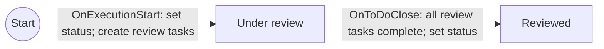
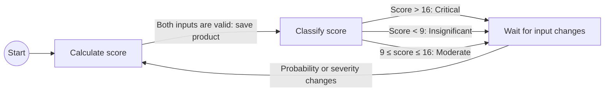
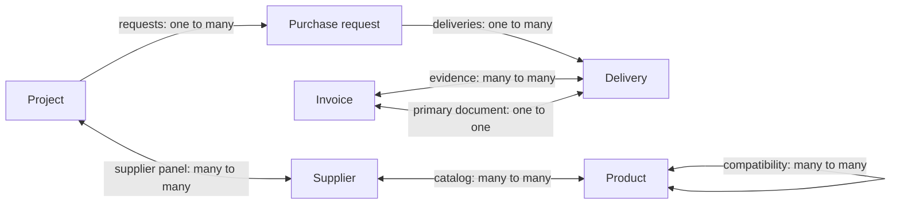

<!--
//
// Copyright © 2026 TraceX SAS.
//
// Licensed under the Eclipse Public License, Version 2.0 (the "License");
// you may not use this file except in compliance with the License. You may
// obtain a copy of the License at https://www.eclipse.org/legal/epl-2.0
//
// Unless required by applicable law or agreed to in writing, software
// distributed under the License is distributed on an "AS IS" BASIS,
// WITHOUT WARRANTIES OR CONDITIONS OF ANY KIND, either express or implied.
//
// See the License for the specific language governing permissions and
// limitations under the License.
-->

# Card types and process authoring

This is the first reference for agents creating or explaining card types and processes. It contains the document shapes, parameter contracts for common operations, expression syntax, execution rules, and worked patterns. Use these contracts directly for routine authoring; the source map at the end is for maintaining this reference, not a required tour of the codebase.

## Start here

1. Define persistent card fields, temporary results, waiting states and data dependencies before writing the graph.
2. Use the single named-block YAML format (`version: 2`) for fields, graphs, typed results and expressions. It compiles to the existing native model and execution engine.
3. For a standalone process, declare existing destination fields/entities as slots. `$slots.field` is its identity; `$card.field` reads its value. For an embedded process, specify `masterTag`, declare local fields, and use their stored names directly. Embedded module import has no standalone slot-binding dialog.
4. Publish object/group outputs with `as`; declare typed task or computation values in `results`; read either with `$context.name`. Use `expr` for transformations. Split the graph into small named states with deliberate branch/action order.
5. Check operation parameters in this guide and the installed workspace model. The installed model is authoritative. Do not infer optional parameters, type constraints, task result aggregation or behavior from operation names.
6. Validate, import and exercise a newly created definition before saving into an existing process. Use the manual checks below. If required behavior is missing or unconfirmed, stop generation and identify it precisely.

| Worked definition | Purpose |
| --- | --- |
| [`risk-management.card.yaml`](./examples/risk-management.card.yaml) | Named card fields, five numeric choices, multiplication and three risk levels |
| [`review-task.process.yaml`](./examples/review-task.process.yaml) | Standalone slots, task group and completion wait |
| [`approval.process.yaml`](./examples/approval.process.yaml) | General approval, locks, object outputs and named references |
| [`estimate-review.process.yaml`](./examples/estimate-review.process.yaml) | Typed task results, calculation pipeline, card writes and branching |
| [`purchase-approval.process.yaml`](./examples/purchase-approval.process.yaml) | Purchase estimate inputs, amount calculation and approval above a budget limit |
| [`procurement-workspace.card.yaml`](./examples/procurement-workspace.card.yaml) | Six related business card types, inheritance, tags, reference fields and four embedded workflows |

[`authoring-v2.schema.json`](./authoring-v2.schema.json) is the machine-readable v2 syntax contract. The v2 examples reference it with a YAML language-server directive, enabling schema-aware completion and structural diagnostics in an IDE with a YAML language server. UI validation additionally resolves the installed model, references and bindings. The schema alone cannot establish operation availability or runtime context values. The recorded work plan and verification history are in [`authoring-plan.md`](./authoring-plan.md).

Package releases and updates belong to the Marketplace plugin and follow its [package versioning plan](../../marketplace/docs/package-versioning-plan.md). The card type and process export menus offer `Make package` and `Create new package version`. Their dialog asks only for an optional package description; ID creation and version increments are automatic. A package is a single `.package.yaml` document containing `version: 2`, `kind`, package metadata and the actual card/process definition sections. Its metadata contains ID, SemVer version, global author account UUID, description and content hash; there is no JSON wrapper with a YAML string. Hashing works on ordinary HTTP origins without Web Crypto. Package ID, version, author and description are also saved on the definition. The new-version action is offered only to its recorded author and reads saved metadata without choosing a previous file. Embedded processes use their card type's package unless they have a standalone package. YAML saves retain package membership; portable definition payloads omit workspace package metadata. These actions update no graph/schema data and use no server preparation API. Marketplace supports packages containing one or more processes, with remembered membership for subsequent releases. Its workspace settings page installs package files, records baselines and bindings, previews local/upstream changes and applies reviewed updates. Card modules receive fresh local identities; process bundles bind to existing card types. Ordinary single-process editors still accept exactly one process. Installation links survive local YAML saves; catalog publishing and discovery remain future work. Processes keep existing in-place editing and execution behavior. A process update needs manual behavioral review and can affect current executions; destructive schema/data changes require a supported migration before application.

### Check YAML from the command line

From the repository root:

```bash
node plugins/process/scripts/validate-yaml.js plugins/process/docs/examples/purchase-approval.process.yaml
```

Or from `plugins/process`:

```bash
rushx validate:yaml docs/examples/purchase-approval.process.yaml
```

Pass several file paths to check them together. The single YAML format supports both packaging modes; the root `kind` selects the mode. Paths are relative to the current directory. `--help` prints usage. A valid file prints `<file>: valid YAML definition (offline)`. Invalid files report the authored property path and line/column when available. Exit codes are `0` when every file is valid, `1` for invalid or unreadable files, and `2` for command usage or compiler setup errors. Checking continues after an invalid file.

The command calls the existing `validateProcessYaml` compiler API. It checks the DSL and compiler semantics described under [Validation boundaries](#validation-boundaries), including graph references, explicit output types and typed results. Files do not embed an operation catalog; required operation parameters and function roles are checked against the installed model in the UI. It does not connect to a workspace or write definitions. Installed operation availability, destination field bindings and runtime behavior still require UI validation and manual execution.

Prerequisites are installed repository dependencies (`rush install`, or `rush update` after dependency changes) and the existing compiled authoring implementation in `plugins/process/lib` with its workspace dependencies. The command never runs a build. After changing the compiler source, refresh its artifacts through the normal development build before using this command.

## Authoring format decision: YAML

**Decision: use YAML as the authoring DSL for card types and processes.** Use declarative YAML for fields, settings, graph structure, and typed slots, with a limited expression language for calculations and conditions. Compile it to the existing native document model and execution engine. Identifiers, stored field keys, LexoRank values, and context definitions should be generated or resolved by the compiler rather than manually maintained in ordinary authoring files.

The single YAML format is implemented in `@hcengineering/process`: `compileProcessYaml(source)` generates native documents, and `parseProcessImport(source, kind)` accepts this format or existing native JSON arrays. Both UI import flows accept `.yaml`, `.yml`, and `.json`. YAML export always uses the same named-block representation and retains every native operation and property. Only `version: 2` is accepted; the removed `version: 1` syntax is rejected with a version diagnostic.

### YAML contract

Use this format for card fields, calculations, tasks, approval, locks, subprocesses, relationships, tags, versioning, result collection, registered functions, native queries, permissions, viewlets and dependent types. The operation and expression contracts below apply to every YAML definition. This represents the existing engine; declarations cannot add unsupported runtime behavior.

```yaml
version: 2
kind: process
processes:
  lock_until_update:
    label: Lock until the card changes
    start:
      begin:
        to: waiting
        on: OnExecutionStart
        actions:
          lock:
            method: LockCard
    states:
      waiting:
        label: Locked
        transitions:
          changed:
            to: done
            on: OnCardUpdate
            actions:
              unlock:
                method: UnlockCard
      done:
        label: Unlocked
```

Use named blocks instead of a list of storage documents. `processes` contains each process; its `start` contains entry transitions, and its `states` contain named outgoing `transitions`. Each transition has `to`, `on` and optional named `actions`. The compiler generates `_id`, `_class`, `space`, `process`, `from` and LexoRank values. YAML declaration order defines state display order, outgoing transition priority and action execution order. Export sorts existing ranked blocks before writing them. Moving a transition in YAML changes its priority; storage ranks are never needed in ordinary authoring.

`label` maps to the process name or state title. An omitted standalone `masterTag` means the destination card type (`__MASTER_TAG__`); embedded processes must specify their owning card type explicitly. Omitted process `context` means an empty map. `on: OnExecutionStart` means an empty trigger parameter object; with parameters, use `on: {OnApproveRequestApproved: {_id: "${$context(approval_request)}"}}`. Use `method: RequestApproval`, with `params` and `context` as needed. Omitted action params become `{}`; `as` creates its result context, otherwise an omitted action context becomes `null`. An action `results` map declares named typed results; earlier explicit result arrays remain supported. Structural context/type metadata uses `id`, `class` and slot `kind`; class names such as `process.ApproveRequest`, `core.ArrOf` and `contact.mixin.Employee` expand to their native ids. To retain a custom class identity containing dots literally, use `class: {ref: custom.Type}`. Native operation parameters and queries stay unchanged, including `_id` keys and `$size` filters.

Built-in method/trigger names expand to `process:method:<name>` and `process:trigger:<name>` without a fixed operation list. Custom operations keep their fully qualified ids. New registered operations and parameters need no new exporter/compiler branches. Model lookup validates referenced methods, triggers and functions before applying; the editor performs that lookup while validating the draft too.

Card modules use the same `processes` grammar plus named `cardTypes`, `tags`, `enums`, `views`, `roles`, `relations`, `permissions`, `attributePermissions` and `sequences`. Declare each type's attributes in its own `fields` map, including fields owned by tags. The enclosing card type or tag supplies `attributeOf`; do not repeat it inside the field. Field block names remain globally unique attribute identities, while `name` is the stored card key used by `$card.name`. Inherited fields stay with their declaring base type. Field order within each owner determines its display order, and full exports keep fields nested under their owners.

The section implies the document class and each block name is its reference identity. Model space is implicit; a non-model `space` remains explicit. A root `fields` section is used when the attribute owner is outside the module; earlier flat declarations remain importable, and local fields are nested on export. New document classes use `documents: {"plugin:class:NewClass": {named_document: {...}}}`. All additional model properties are retained. If an extension property collides with a DSL name (for example a native process property named `states`, or a native card-type property named `fields`), the exporter places it under `native` on that block. This escape is for extension data, not ordinary process authoring. Earlier v2 `model` document lists remain importable but are no longer exported.

Write ordinary localized display labels as text: `label: Estimator`. In v2, slot labels and the labels of card types, tags, fields and permissions are converted to native `embedded:embedded:Estimator` on import and shortened back to text on export. Existing resource ids such as `plugin:string:Label` and explicit embedded ids remain valid. Embedded text that itself resembles a resource id retains its explicit prefix to avoid ambiguity. Native escapes and earlier `model` lists preserve their exact values. Process/state names and action output/result labels are ordinary strings and are not converted.

#### Named outputs and references

Ordinary actions publish their result with `as: approval_request`. No action context or process context map is needed: the compiler generates the result class, action/producer references, display index and selected-context value. The result class comes from the method model `createdContext` contract. UI validation/import use the installed workspace model; offline `compileProcessYaml(source)` requires an explicit output class when no model is supplied. `compileProcessYaml(source, model)`, `parseProcessImport(source, kind, model)` and `validateProcessYaml(source, kind, model)` accept a model explicitly. The installed model remains authoritative for operation availability.

```yaml
request_approval:
  method: RequestApproval
  params:
    user: $card.approvers
    field: $slots.approvers
  as: approval_request
```

| Reference | Meaning | Native representation |
| --- | --- | --- |
| `$slots.approvers` | Bound field name; for entity slots, the bound model id | `__SLOT_approvers__` |
| `$card.approvers` | Current card field value; a declared attribute slot resolves its stored name | `${@__SLOT_approvers__}` |
| `$card.owner.name` | Nested current card field value | `${@owner.name}` (or the declared owner attribute slot) |
| `$context.approval_request` | A published action output | `${$context(approval_request)}` |
| `$context.approval_request._id` | A field of that output | `${$context(approval_request,_id)}` |

Use `$slots` for identities and `$card`/`$context` for values. These meanings do not change depending on parameter names. References are whole YAML string values, never interpolated inside ordinary text. Names use letters, digits, underscores and hyphens; dots separate field selectors. Unknown slots/outputs, malformed references, duplicate output declarations and mixing `as` with an explicit action context produce errors at the authoring block path. `$card` may also read actual stored card field names, such as `$card._id`; declared entity slots cannot be read as card attribute values.

Keys in params/query objects may use `$slots.field` for stored field selectors. Use `{literal: "$context.literal_text"}` when a string should remain text instead of becoming a reference. The same wrapper preserves arbitrary literal objects/arrays. Native exports escape reference-looking literal values automatically; escaped native parameter keys use `$literal:<original key>`. Native `${...}` expressions remain supported for transforms, reductions, functions, user requests and relations. The exporter uses shorthand only when decoding restores the exact original expression, so modifiers and serialized legacy contexts remain intact.

For a portable file that can also be checked offline, declare only the output type used by the action:

```yaml
as: {key: approval_request, class: process.ApproveRequest}
```

An explicit `label` preserves the result's display name when it was inferred from a method parameter. YAML exports and repository examples use this form without a root operation catalog. In the UI, a plain `as: approval_request` can still infer its class from the installed method's `createdContext` contract. A missing contract is reported rather than guessed, and the destination model still validates the method before apply.

For exported specialized metadata, use `as: {key: approved_tag, class: $slots.approved_tag, label: Approved tag, order: 2}`. `class`, `label` and `order` are optional overrides; `order` preserves existing display order. Class hints must describe an already supported native result, not invent a method result. Additional native context metadata is retained under `as.native`; producer/action/value wiring is always generated. Unusual native context expressions, action-context extension properties and methods lacking an output contract retain their explicit context definitions. Ordinary task input/result contexts are generated from named `results` below. Unusual contexts and earlier result arrays retain their explicit metadata. The exporter removes only contexts that the shorthand can reproduce completely.

YAML exports omit the installed operation catalog and document audit metadata (`modifiedBy`, `modifiedOn`, `createdBy`, `createdOn`). Business fields or literal action values with these names retain their meaning. Operations, function expressions, explicit output types and other definition properties remain portable; operation availability and parameter contracts come from the installed model. If a requested behavior is absent or unconfirmed, stop generation and report exactly what is missing.

#### Typed results

An object output (`as`) identifies a created object or task group. A typed `results` map describes values produced or collected by the action. They are independent, and an action may declare both. No repeated process context map, producer/action links, indices or native result ids are needed.

```yaml
request_review:
  method: CreateToDo
  params:
    title: Provide an estimate
    user: $card.reviewers
    completionMode: any
    withRollback: true
    askRequired: true
  as: review_tasks
  results:
    effort: {label: Estimated effort, type: number}
    rate: {label: Cost per unit, type: number}
```

Wait for `OnToDoClose: {_id: $context.review_tasks}` before reading `$context.effort` or `$context.rate`. Creating the task group does not produce those input values. The native task's `completionMode: all` suppresses user results; use `any` for this pattern. Declaring results does not change a method's behavior: `SetContext` requires exactly one result; task actions collect their declared inputs through the existing completion form. The compiler does not assume that every registered method supports arbitrary results.

| Result property | Meaning |
| --- | --- |
| `type` | Required value type |
| `label` | Optional display label, defaults to the result name; an empty label is preserved |
| `field` | Optional native result `key`: an associated stored field identity, e.g. `$slots.cost`; a value reference is rejected |
| `selectionSpace`, `excludeRelation` | Existing reference-selection constraints, with the native semantics below |
| `order` | Optional nonnegative display index for preserving existing exports; ordinarily generated |
| `native` | Unknown native result extension properties; never generated identity/name/type wiring |

Readable types are `string`, `number`, `boolean`, `date`, `markup`, `{array: number}`, `{ref: contact.mixin.Employee}` and `{enum: decision_enum}`. References and arrays compose, e.g. `{array: {ref: contact.mixin.Employee}}`. The referenced enum/class must already exist or be declared in the module; these forms do not create it. The same type syntax works in fields, attribute slots and a process `resultType`. A slot with a `type` defaults to an attribute slot and `core.Attribute`: `slots: {cost: {type: number}}` is sufficient. Entity slots retain explicit `kind` and `class`. Full model types remain supported (`{class: extension.NewType, ...}`); an unusual type with colliding properties uses `{native: {_class: ..., ...}}`. No numeric range, enum-label conversion or input guard is inferred from a type name.

Generated process result metadata exactly follows native synchronization: `isResult: true`, the declared type, owning action/transition, context selector, and a shared display sequence after ordinary `as` outputs. For a reference type, its context class is the referenced class; for arrays, it follows the engine's element-type rule. Export uses named results only when it can reproduce every native property. Earlier result arrays and unusual explicit context maps remain supported.

#### Declarative expressions

Use `expr` for computations in any parameter value, including nested function properties. It assembles the existing native context expression; it executes no JavaScript.

```yaml
calculate_cost:
  method: SetContext
  params:
    value:
      expr:
        from: $context.effort
        pipe:
          - Multiply: {value: $context.rate}
  results:
    total_cost: {label: Total cost, type: number}
```

After that action, `$context.total_cost` reads the initialized result. A subsequent `UpdateCard` action with `params: {$slots.cost: $context.total_cost}` persists it on the card. An outgoing card-match transition can then branch on that field. A temporary execution result is not automatically a card field or a trigger predicate.

| Expression property | Semantics |
| --- | --- |
| `from` | Exactly one value reference (`$card`/`$context`), native context expression, or `{literal: value}` source |
| `call` | Alternative to `from`: one registered context-producing function with its properties |
| `reduce` | Native source function: reduces/processes the source object before selecting its `key` |
| `pipe` | Ordered array of registered value transforms/conversions after field selection |
| `fallback` | Literal fallback value used by the native evaluator; reference-looking strings here remain literal |

A function is either a short name with no properties, such as `NumberFromString`, or a single-entry mapping, such as `{Multiply: {value: $context.rate}}`. Custom function ids remain fully qualified. There is no per-function compiler: newly registered functions use the same grammar. The installed model's `type` enforces `context` for `call`, `reduce` for source reduction, and `transform` or `convert` for `pipe`. Missing installed functions and incompatible roles are errors. Input/output types and property semantics require their actual contract; role checking is not proof of complete type compatibility.

Example for numeric enum choices:

```yaml
expr:
  from: $card.probability
  pipe:
    - StringFromEnum
    - NumberFromString
    - Multiply:
        value:
          expr:
            from: $card.severity
            pipe: [StringFromEnum, NumberFromString]
```

Use a literal source for constants: `expr: {from: {literal: 5}, pipe: [{Multiply: {value: 2}}]}`. Ordinary strings are never templates. `{literal: {expr: ...}}` preserves a native object whose keys resemble expression syntax; exporters add escapes automatically. Function property expressions are resolved by that function's existing contract, not automatically by every function. Quotes, newlines and values that the text grammar cannot preserve use the engine's supported JSON context encoding internally. Canonical native expressions export as YAML pipelines; legacy/noncanonical expressions stay unchanged for exact round trips.

#### Finding references in the current card space

The `FindObjects` context function searches the referenced document type using a native `DocumentQuery` and optional `SortingQuery`. In the visual context selector, **Find objects** is available for `Ref` and `Arr<Ref>` fields. Clicking it opens a separate popup that stays open when the pointer leaves it. The target type comes from the field; filters reuse the process criteria editor, and sorting can contain several fields in priority order. The saved context configuration can be reopened to edit the filters and ordering.

Function properties:

- `_class`: required target class or mixin id, including a bound type slot.
- `query`: optional native filter, default `{}`. Values may read card fields or process context, including inside operators and arrays. The criteria editor's wildcard-wrapped `$like` context values are resolved too. Field keys resolve process bindings and mixin ownership. Storage-supported operators are accepted; top-level `$or` is unsupported.
- `$sort`: optional native sorting map. Its key order defines priority; `1` means ascending and `-1` descending. Field keys resolve bindings and mixin ownership.

The server always restricts the query to the execution card's current `space`, loaded from the card rather than the execution document. A supplied `query.space` cannot change this scope. The query uses the target class/mixin and its normal storage inheritance behavior.

The function returns an ordered array of document ids. An `Arr<Ref>` field receives that array, including `[]` when nothing matches. A `Ref` field uses the existing `FirstValue` source reduction to take the first id; no matches raise the normal empty-function-result error unless a literal fallback is configured. Without `$sort`, storage order is used.

For a YAML expression, call the registered function and add `reduce: FirstValue` only when one reference is required:

```yaml
expr:
  call:
    FindObjects:
      _class: card:class:Card
      query:
        title: $card.title
      $sort:
        modifiedOn: -1
        createdOn: -1
  reduce: FirstValue
  fallback: null
```

#### Validation boundaries

The compiler checks YAML structure, graph ownership/destinations, named references, result types, duplicate outputs, function roles and model-declared required parameters. Missing required values report their authored path; `false` and `0` are valid values. Model defaults remain suggestions and are never inserted implicitly. Semantic diagnostics include the nearest authored block's line/column. The UI also checks operation availability and destination slot bindings before writing.

The current model does **not** universally declare optional parameter schemas, conditional requirements, method result cardinality, function-property types, input validation ranges, or when a context becomes available along every graph path. A method's `objectClass` is not its parameter schema. Additional definition metadata does not give an operation new execution semantics. Until those contracts exist, use the verified operation descriptions/examples and explicitly check producer-before-consumer behavior. These are limits of current model information, not reasons to invent YAML functionality.

The engine additionally has one active state per execution, ordered first-matching transitions, and a 100-step immediate-chain limit. Small named states are logical authoring blocks; they do not imply parallel branches, joins, arbitrary scripts or automatic input aggregation. A fully verified parallel/aggregation language would require an engine contract first.

For ordinary authoring, use readable symbolic ids such as `approval_process`, `waiting_for_approval`, `request_approval` and `approval_request`; references use the same names. A new standalone import generates actual graph, action, result, context and user-request ids. Standalone UI exports generate readable names for these identities and named slots automatically. Keep each state focused on one logical block, with explicit inputs, produced contexts, event/predicate, and ordered outgoing actions. Keep outgoing branches in deliberate YAML order; the compiler restores their native priority ranks.

Slots use a process `slots` map with `kind: attribute | class | association | process | unknown`, `class`, and optional `type`, `enumValues`, `label`, `name`, `memberOf`. Use `__SLOT_name__` in field keys, entity references or native context expressions. `memberOf: __SLOT_owner_type__` binds a dependency to a selected card type. The existing binding dialog supports every kind, prefills compatible bindings when editing, and clears dependent selections if their owner changes. Unknown slots accept an explicit model object id or field name; apply validates that it exists. Platform classes and their standard fields retain their native references rather than becoming workspace dependencies. Full-model slots may intentionally share a destination field.

Native expressions remain strings, for example `${@__SLOT_approvers__}`, `${$context(approval_request)}`, `${$relation(__SLOT_steps__,B,_id,Steps)=>SOURCE(All)}` and `${=>CurrentDate()}`. Updates, triggers, function modifiers and user requests use the existing engine syntax documented below. Rebinding resolves structural identities and parsed expression references, preserving literal labels, names, enum choices, constant contexts and fallback values. All context metadata and action results remain in their named blocks.

Identity behavior is explicit:

- **Standalone Create new/import:** new process, state, transition, action, result, context and user-request ids; destination owner is the selected card type. Enum dependency documents retain native identities, as in JSON.
- **Save current process:** retain the selected process id, owner and rank; replace its graph and complete definition in the existing apply transaction, removing obsolete properties and graph documents. Active executions are not migrated or inspected.
- **Full card module file import:** retain native ids and use existing JSON import/update behavior, including attached documents and workspace sequences.
- **Card editor Create new:** copy the complete module with fresh document and graph identities, rebinding its dependent classes, enums, associations, viewlets, roles, sequences and contexts. Existing types are not overwritten.

[`approval.process.yaml`](./examples/approval.process.yaml) is a small complete DSL example: bind Approvers to an employee array and Approved to a tag applicable to the destination card. The graph requests approval and locks the card, waits for the approval request context, adds the tag on approval, and unlocks on rejection. It uses named references and three focused states. The workspace approval export can additionally retain section locks, task results, cancellation and nested subprocesses without changing this format.

### Two packaging modes

| Mode | Owns | Dependencies and native output |
| --- | --- | --- |
| Card module | Card types, fields/enums and named embedded processes | Declare model sections and give each process its owning `masterTag`. Field calculations are explicit process actions; field metadata does not generate a process. Produces a complete native module with the declared identities. |
| Standalone process template | A reusable process graph and typed slots | Destination card types, fields and other model entities already exist. Supply every slot binding through the import dialog. Produces native process documents with `requiredSlots` and slot placeholders. |

Both modes use the same named process/state/transition/action grammar and expression semantics. A standalone template does not create destination fields.

Minimal card module:

```yaml
version: 2
kind: card
cardTypes:
  example_card:
    label: Example card
    extends: card:class:Card
    kind: 0
    icon: card:icon:MasterTag
    fields:
      summary:
        name: summary
        label: Summary
        type: string
        isCustom: true
```

Minimal standalone process:

```yaml
version: 2
kind: process
processes:
  mark_reviewed:
    label: Mark reviewed
    slots:
      status:
        label: Status
        type: string
    start:
      begin:
        to: reviewed
        on: OnExecutionStart
        actions:
          set_status:
            method: UpdateCard
            params: {$slots.status: Reviewed}
    states:
      reviewed:
        label: Reviewed
```

The root contains `version: 2`, `kind: card | process` and the named sections. Block names identify definitions; display labels are separate. YAML tags creating non-JSON objects, multiple documents, cyclic aliases and excessively deep nesting are rejected. Files are limited to 1 MiB. Native extension properties remain supported, so structural validation is not a universal typo checker for native model fields.

Attribute slots bind to actual `Attribute.name` values, not attribute document ids. Entity slots bind to model ids. The importer checks destination types, owners and enum values. Slots may intentionally share a destination field. Missing or incompatible bindings are errors.

Standalone imports generate fresh graph/action/result/context identities. Card module file imports retain their declared native identities, like JSON. The card editor's Create new action clones the module with fresh identities and consistent references. Save current process retains the selected process id, owner and rank and replaces its graph; active executions are not migrated.

### Examples and manual import

- [`risk-management.card.yaml`](./examples/risk-management.card.yaml): risk card fields, shared scale/level enums and an explicit automatic assessment process. Import the module, create a card, check 5×5 → Critical, 3×3 → Moderate and 1×5 → Insignificant, then change either input to verify recalculation.
- [`review-task.process.yaml`](./examples/review-task.process.yaml): standalone review. Bind Reviewers to an employee-array field and Status to a string field. Start on a card with reviewers and finish all tasks; status changes from Under review to Reviewed.
- [`purchase-approval.process.yaml`](./examples/purchase-approval.process.yaml): task inputs, amount calculation and conditional approval. Bind its four slots and check the exact budget boundary and both approval outcomes.
- For a standalone risk calculator, keep the same graph, declare its four fields as typed slots, and replace field selectors with `$slots.name` and value reads with `$card.name`. Keep enum dependencies and their actual choice sets explicit; use exported field bindings rather than guessing workspace identities.

Native JSON examples below document generated model shapes and existing import behavior. YAML authoring and Unified Format workspace imports remain separate formats.

### Export and UI editor usage

- **Card types:** The type settings export menu offers JSON and YAML. The YAML editor button in the type list starts a new module; the button beside a type's export opens its supported definition as a draft for a new type.
- **Processes:** The export menu offers JSON with slots, JSON without slots, and YAML DSL. The process section's YAML editor button starts a new standalone draft. The button in an existing process opens its supported definition with detected field bindings.
- **Editing:** The dialog adapts to the viewport, wraps footer actions and keeps the text area and diagnostics inside its available height. The monospace editor highlights YAML keys, strings, numbers and comments, and supports two-space Tab insertion. It validates YAML syntax and the complete DSL contract on each change. Parser errors include line/column; semantic errors identify the property path and the location of its nearest authored block. Invalid drafts cannot be applied, but can be downloaded for later editing. Open YAML file replaces the draft.
- **Applying:** Create new definition routes through the existing card or process import flow. Processes request slot bindings. Save current process is available when opened from a process; it updates that process and replaces its graph in one apply operation. The slot dialog prefills previously detected bindings; changed slots can be rebound. Cancelling it keeps the draft open. Saving does not inspect or migrate active executions.
- **Coverage:** Every YAML export uses the same named-block format for operations, contexts, metadata, permissions, relations, inheritance, dependent types and localized labels. Standalone exports include readable graph identities, typed entity slots and explicit output classes, without document audit fields or an operation catalog. The editor validates this single format.

Manual verification:

1. Export a risk module and review process as JSON and YAML; verify extensions, the single named-block YAML grammar and existing JSON imports. A removed version 1 YAML file must report an unsupported version.
2. Open the YAML editor, introduce broken indentation or an unknown slot/output reference, and check the visible diagnostic and disabled apply buttons. Fix it, download the draft, reopen it, and import it with field bindings.
3. Open an existing review process, change its label and task title, and save the current process. Verify the process id stays the same, the new graph is shown, and obsolete states/transitions are gone. Then create a new definition from the same editor and verify it appears as a separate process.
4. Run newly saved/imported review and risk processes on cards. For risk, check 5×5 → Critical, 3×3 and 4×4 → Moderate, 1×5 → Insignificant, and recalculation after changing either input.
5. Export an approval process or a module with permissions/relations as YAML; verify it uses `version: 2`, retains definition operations/properties, and omits document audit fields and the operation catalog. Open the process in the YAML editor, change a task title, save it and verify its id remains unchanged. Bind every dependency when importing a new process. Change a method id to one absent from the installed model and check that the editor reports the missing operation and blocks apply.
6. Open `estimate-review.process.yaml`. Bind `reviewers` to an employee-array field, `cost` to a number field and `status` to a string field. Give the test card at least one reviewer, run the new process and complete one task with effort `10` and rate `10`: expect cost `100`, status `Accepted`. On another execution, use `10` and `10.1`: expect cost `101`, status `Needs approval`. Confirm task inputs and `total_cost` appear as typed outputs in the visual editor. Change `pipe` to a string or remove `SetContext.params.value`: expect a diagnostic and disabled apply. Then save a renamed version into the current process and check its identity is retained.

### Existing YAML support and reuse

The repository already has a Unified Format YAML importer. Process authoring reuses `js-yaml` independently and does not apply Unified Format variable substitution. These references record the comparison:

| Existing implementation | Confirmed behavior |
| --- | --- |
| [`packages/importer/src/huly/cards.ts`](../../../packages/importer/src/huly/cards.ts) | Imports YAML definitions for master tags, tags, enums, and associations; creates custom attributes from `properties`. |
| [`packages/importer/src/huly/schema.ts`](../../../packages/importer/src/huly/schema.ts), [`validation.ts`](../../../packages/importer/src/huly/validation.ts) | Custom configuration schemas and validation for these definitions. Existing keys include `class`, `title`, `properties`, `enumOf`, `refTo`, and `isArray`. |
| [`packages/importer/src/huly/parser.ts`](../../../packages/importer/src/huly/parser.ts) | Uses `js-yaml`; reads YAML files and Markdown frontmatter and substitutes configured variables. |
| [`dev/import-tool/docs/huly/README.md`](../../../dev/import-tool/docs/huly/README.md), [`example-workspace`](../../../dev/import-tool/docs/huly/example-workspace) | Documentation and existing YAML examples for workspace objects and custom card types. |

These references establish existing YAML parsing, card type import, and custom configuration patterns. The inspected card schemas do not define process graphs or typed process slots, so they do not establish support for the new DSL.

Reuse the existing format or infrastructure where its semantics naturally fit the new authoring model. Compatibility is optional, not a design constraint: do not distort the new DSL or add adapters solely to force reuse. If the existing format does not fit, define a separate format and reuse only suitable pieces, such as YAML parsing or validation patterns. Keep format detection explicit so an existing file is not accidentally interpreted as a new DSL document.

The Unified Format parser substitutes `${...}` variables, which overlaps native process expression syntax. Assess that behavior before reusing the parser; YAML parsing can be reused independently of variable substitution.

## Prefer small, readable process blocks

Split a process into small, named logical blocks with one business responsibility each. Each block should be understandable from its name, inputs, ordered actions, output changes or contexts, and its waiting or completion condition.

- Use names such as `Calculate score`, `Classify score`, and `Wait for input changes` instead of anonymous numbered phases.
- Keep related actions together, especially when later actions depend on earlier card writes or output contexts. Preserve transaction boundaries and execution semantics when reorganizing an existing process.
- Show the trigger and outgoing destinations explicitly. Keep branching predicates simple and mutually exclusive where possible.
- Make dependencies between blocks explicit: persistent card fields, published execution contexts, and external slots. Check that a producer executes before every consumer.
- Separate unrelated responsibilities such as calculation, review tasks, and notifications; avoid one large transition that conceals several business phases.
- Use the smallest graph that communicates the behavior. Do not introduce a state for every trivial assignment or split a calculation into multiple processes solely to make it shorter.

A logical block is an authoring and readability concept, represented by existing states and cohesive transitions. It does not imply a new runtime entity or an automatic subprocess call. Use a real subprocess only when separate execution or reuse is needed and its parameter/result contract is verified. The risk example demonstrates three readable blocks within one active process; the review example separates task creation from waiting for completion.

## Process generation rule: stop on missing functionality

This rule applies only when generating process definitions or templates. It does not restrict general development work.

During process generation, if required functionality appears to be missing or its support is not confirmed, **stop generation and report exactly what is missing and which requested process behavior depends on it**. Identify the missing action, trigger, transform, API, parameter contract, or workspace definition. Do not invent an identifier, parameter, expression, operation, or implicit engine behavior; do not silently substitute a workaround or extend the engine. Wait for the user's direction before continuing generation.

For example: “The enum labels contain descriptions, but this guide does not define a supported label-to-number mapping operation. Numeric conversion alone cannot implement the requested calculation. A verified mapping operation or numeric enum values are needed.”

An absent workspace export is a missing input, not evidence that the engine lacks a feature. State that distinction explicitly. Keep generated files, labels, descriptions, enum values, and examples in English.

TraceX processes are graphs attached to card types or tag mixins. A transition combines a trigger, a destination state, and an ordered list of actions. To build a process from a business description, first define the card data, then the waiting states, events, actions, and data dependencies between actions.

For an existing workspace process, start from its exported JSON and the corresponding card type or module export. Source code defines the engine and available operations; the workspace model contains the actual configured process definitions.

Use the parameter contracts below rather than inferring parameters from UI labels or method names. The method catalog is not a complete schema: for example, `UpdateCard` declares no required parameter names, but its server implementation rejects an empty parameter object.

## Card data comes first

A `MasterTag` is a dynamic class extending `card.class.Card` or another master tag. A `Tag` is a mixin adding a separate set of fields. A card's `_class` identifies its master tag; applied tag mixins provide additional sections and attributes.

Custom fields are `core.class.Attribute` documents in `core.space.Model`:

| Attribute property | Meaning |
| --- | --- |
| `attributeOf` | Owning master tag or tag mixin |
| `name` | Stored property key used in action parameters and DSL expressions |
| `_id` | Attribute document identifier; distinct from `name` |
| `label` | Display label, typically produced with `getEmbeddedLabel` |
| `type` | Native property type such as `TypeString`, `EnumOf`, `RefTo`, or `ArrOf` |
| `required` | Whether the field is required |
| `automationOnly` and `readonly` | Editing restrictions used by custom field creation |
| `rank` | Display order |

The UI generates field names as `custom` plus a generated id. A label such as “Reviewers” is not the stored field name. Bind an attribute slot to `attribute.name`, not `attribute._id`.

Before designing transitions, specify the business fields, types, cardinality, allowed values, and owners. Decide whether each value is persistent card data or a temporary execution result. A process state does not automatically change a card's status field; use `UpdateCard` when a visible business status must be updated.

Card spaces have a `types` restriction. Check both the target type and the relevant creation path when adapting a type to a space; space handling may differ between UI, form, and agent tools.

A full card module export includes its type, attributes, permissions, relationships, referenced types, and export extensions such as processes. A process-only export expects a compatible destination type and its fields to already exist.

## Native document and field shapes

The import artifact is a JSON array of documents. Every definition has `_id`, `_class`, and `space: "core:space:Model"`. Omit runtime metadata such as `createdOn`, `modifiedOn`, `createdBy`, and `modifiedBy`.

| Document class id | Definition properties |
| --- | --- |
| `card:class:MasterTag` | `extends`: parent class id, normally `card:class:Card`; `kind: 0`; `label`: embedded label; `icon: "card:icon:MasterTag"`; optional `description`, `background` |
| `card:class:Tag` | Mixin type: `extends`: target class id; `kind: 2`; `label`: embedded label; `icon: "card:icon:Tag"`; optional `rank`, `description` |
| `core:class:Enum` | `name`: display name; `enumValues`: array of allowed strings |
| `core:class:Attribute` | `attributeOf`: owning type id; `name`: stored key; `label`: embedded label; `type`: native type object; custom fields use `isCustom: true`; optional `required`, `readonly`, `automationOnly`, `defaultValue`, `rank` |
| `process:class:Process` | `masterTag`, `rank`, `name`, `description`, `context`; optional `autoStart`, `showInHeader`, `automationOnly`, `parallelExecutionForbidden`, `requiredSlots`, `bindings`, `resultType` |
| `process:class:State` | `process`: process id; `title`: display title; `rank` |
| `process:class:Transition` | `process`: process id; `from`: state id or `null`; `to`: state id; `trigger`: trigger id; `triggerParams`: object; `actions`: ordered array of steps; `rank` |

Embedded labels have the form `embedded:embedded:Probability`, produced by `getEmbeddedLabel('Probability')`. Enum choices and process/state names are ordinary strings. A new custom field name conventionally uses `custom` plus a generated id. Generate fresh ids for new definitions; use exported ids when updating existing definitions. A reference to an existing workspace object must come from that workspace, not from an invented name.

The following are complete native `Attribute.type` objects; replace the example enum and referenced type ids with the corresponding definition ids:

| Value | Type object |
| --- | --- |
| String | `{"_class":"core:class:TypeString","label":"core:string:String"}` |
| Number | `{"_class":"core:class:TypeNumber","label":"core:string:Number"}` |
| Enum choice | `{"_class":"core:class:EnumOf","label":"core:string:Enum","of":"enumId"}` |
| Employee reference | `{"_class":"core:class:RefTo","label":"core:string:Ref","to":"contact:mixin:Employee"}` |
| Array of employee references | `{"_class":"core:class:ArrOf","label":"core:string:Array","of":{"_class":"core:class:RefTo","label":"core:string:Ref","to":"contact:mixin:Employee"}}` |

For an automation-only field, use both `readonly: true` and `automationOnly: true`. For editable enum input, set `defaultValue` to an allowed enum string, not a number. Declare each enum document once and let multiple fields reference it.

### Steps and output definitions

A step is an object embedded in `Transition.actions`, not a separate model document:

```json
{
  "_id": "__ACTION_0__",
  "methodId": "process:method:UpdateCard",
  "context": null,
  "params": {
    "__SLOT_status__": "Under review"
  }
}
```

`context` is `null` when the action does not publish an object/group output. An action that publishes an output uses `context: {"_id":"__CONTEXT_0__"}`. Optional `results` contains typed values or user inputs, each shaped as `{"_id":"resultId","name":"Result name","type":nativeType}` with an optional `key` for the associated object field.

For every published object/group output, `Process.context` contains a definition like this:

```json
{
  "__CONTEXT_0__": {
    "name": "Review tasks",
    "_class": "process:class:ProcessToDo",
    "action": "__ACTION_1__",
    "index": 1,
    "producer": "__TRANSITION_0__",
    "value": {
      "type": "context",
      "id": "__CONTEXT_0__",
      "key": ""
    }
  }
}
```

`index` is the display sequence of published contexts; `syncContext` assigns it starting at 1 across the process outputs. It is not an action array index. A typed scalar result additionally declares `isResult: true` and `type` in its context definition; its `_class` is the value type's class. The result identifier comes from `Step.results`, not from the step's own `_id`. A process with only card writes uses `context: {}`.

### Ordering

Ranks are ordered LexoRank strings. `0|400000:`, `0|800000:`, `0|c00000:`, `0|g00000:`, `0|k00000:`, `0|o00000:`, and `0|s00000:` are a valid ascending sequence for a small new example. Generate more ranks with `makeRank` or `genRanks`; preserve existing ordering when editing an export.

## Definition and execution are separate

| Entity | Role | Main links |
| --- | --- | --- |
| `Process` | Reusable definition and settings | `masterTag`, `context`, optional `resultType`, `bindings` |
| `State` | A point where execution can wait or finish | `process`, `title`, `rank` |
| `Transition` | Event or condition plus actions moving execution | `process`, `from`, `to`, `trigger`, `triggerParams`, `actions` |
| `Step` | One action embedded in a transition | `_id`, `methodId`, `params`, `context`, optional `results` |
| `Execution` | One running instance for a card | `process`, `card`, `currentState`, `status`, `context`, `rollback` |
| `ExecutionLog` | History of started, transition, or rollback events | `execution`, `transition`, `action` |

Definitions are stored in the model. Runtime executions and tasks are separate documents. Generating a definition does not require generating an `Execution` document.

`Process.context` describes output names, types, and producing actions/transitions. `Execution.context` holds the values for a particular run. The server's `syncContext` synchronizes the definitions from `Step.context` and `Step.results`.

`Process.autoStart` controls automatic creation of executions for applicable card/version events. `Trigger.auto` controls automatic checking of outgoing transitions after a transition executes. These flags have different purposes. `showInHeader`, `automationOnly`, and `parallelExecutionForbidden` control exposure and execution restrictions; they do not define the graph.

## Execution rules that affect the graph

1. A starting transition uses `from: null`. The editor initially creates an `OnExecutionStart` transition. Standard process design should use one clear starting transition: execution creation currently takes the first transition with `from: null`.
2. For normal event handling, `findTransitions` selects transitions for the event and current state, ordered by `rank`. `pickTransition` returns the first whose server check passes. Overlapping conditions therefore need deliberate priority or mutually exclusive predicates.
3. Actions run in their array order on the chosen transition. They are not executed merely because a state exists.
4. Action output contexts become available as actions run. Card updates are reflected in the transition's card cache, so later actions can read the updated values.
5. The collected transition transactions are applied with a match on the execution's current state. On success, the engine updates the state, context, rollback history, and execution log.
6. A destination with no outgoing transitions for that process sets `Execution.status` to `Done`. Naming a state “Done” has no execution semantics.
7. `checkNext` checks outgoing transitions whose triggers have `auto: true`. A matching transition can execute immediately; a state intended for waiting needs a condition that remains false until the required event or data arrives.
8. Immediate transition chains have a depth limit of 100. Avoid automatic cycles that never reach a wait.
9. A failed action records an execution error and stops the transition. Rollback depends on the selected methods and trigger implementation; do not assume every external side effect can be reversed.

Use native LexoRank strings from `makeRank` or `genRanks` when generating documents. `rank` is not an arbitrary sequence number.

## Common operation contracts

These contracts cover card calculations, field updates, task completion, and typed execution values. They are not a claim that every platform operation is documented here. If the requested behavior needs an operation or parameter contract not covered here or by a supplied known example, apply the primary rule and report the gap.

### Actions

Use the exact `methodId` shown below. `params` values can be literals or native context expressions.

| Method id | Parameters | Output and requirements |
| --- | --- | --- |
| `process:method:UpdateCard` | Nonempty object mapping stored attribute names to new values | Writes the current card. `context: null`. Attribute slots resolve to field names. Declare visible business status updates explicitly. |
| `process:method:CreateToDo` | Required `title`, `user`; explicitly set `completionMode: "all"` or `"any"` and `withRollback`; optional `description`, `dueDate`, `field`, `askRequired` | `user` is an employee reference or an array of them. Empty recipients are an error. Publishes a task group under `Step.context._id`. In `all` mode, user results and `askRequired` are suppressed. |
| `process:method:RequestApproval` | Required `user`; optional `field`, `description`, `dueDate`, `priority`, `withRollback`, `actionType` | Creates an approval request group. Publish it with `as` and use the approval decision triggers below. See the [complete parameter contract](#requestapproval-parameters-and-decisions). |
| `process:method:SetContext` | Required `value`; the step must declare exactly one typed entry in `results` | Initializes that result in execution context. Use `context: null`. Read it with `${$context(resultId)}` after this action. |
| `process:method:UpdateContext` | Required `contextId`: literal result id, and `value` | Updates an already initialized result whose context definition has `isResult: true` and a `type`. It does not create a definition or write a card field. |

Task parameters do not inherit the method catalog's defaults when raw JSON is executed. The catalog suggests `completionMode: "all"` and `withRollback: true`; the raw server fallback is `"any"` and `false`. Set both explicitly.

### RequestApproval parameters and decisions

`RequestApproval` creates one `process.ApproveRequest` per supplied recipient, all sharing one group identity. Its model declares only `user` as required. Values can be literals or supported context expressions resolved before the action runs.

| Parameter | Type / required | Runtime behavior when supplied or omitted |
| --- | --- | --- |
| `user` | Employee reference or array of employee references; required | Recipients, e.g. `$card.approvers`. Missing or empty recipients fail the action. Guest recipients must already have read access to the card. |
| `field` | Stored card attribute name; optional | Enables synchronization of pending requests with the card's recipient field. Use `$slots.approvers` for its identity, not `$card.approvers` for its value. Omit it for a fixed recipient list. |
| `description` | Markup string; optional | Request description; defaults to an empty string. |
| `dueDate` | Timestamp in milliseconds since the Unix epoch; optional | Request due date; omitted means no due date. |
| `priority` | `time.ToDoPriority` numeric value; optional | `0` High, `1` Medium, `2` Low, `3` No priority, `4` Urgent. Defaults to `3` (No priority). |
| `withRollback` | Boolean; optional | Defaults to `false`. When `true`, removal of a request can trigger the engine's task-removal rollback path. This does not mean that rejection rolls back the process. |
| `actionType` | `approve` or `review`; optional | Selects the positive button label: Approve or Review. Omitted behaves as Approve. Both variants record the same approval decision and use the same triggers. |

For `field` synchronization, a nonempty edited recipient list adds missing recipients and removes unfinished requests for removed recipients. Completed requests are retained; clearing the field does not cancel the group. `RequestApproval` does not lock the card; use an explicit `LockCard` action if locking is part of the intended process.

The action publishes a **group identity**, not a single request identity or an array of recipient ids. Use `as: approval_request` and pass `$context.approval_request` directly as the decision trigger's `_id`:

```yaml
request_approval:
  method: RequestApproval
  params:
    user: $card.approvers
    field: $slots.approvers
    withRollback: false
    actionType: approve
  as: approval_request
```

`OnApproveRequestApproved: {_id: $context.approval_request}` succeeds when every request in the group has `approved: true`. `OnApproveRequestRejected` with the same `_id` succeeds when any request has `approved: false`. Pending requests have neither decision. Both triggers have `auto: true`; model two outgoing transitions from the waiting state and define each outcome explicitly.

There is no approval `completionMode` parameter: approval always requires every request, and one rejection is sufficient. The runtime uses the fixed title `Approve request`; `title` and `askRequired` do not configure this action. Do not transfer `CreateToDo` parameter behavior or result aggregation assumptions to approval requests.

For offline approval output typing, use `as: {key: approval_request, class: process.ApproveRequest}`. The UI checks required parameters and trigger contracts against the installed model; no operation catalog is embedded in the YAML file.

See [`approval.process.yaml`](./examples/approval.process.yaml) for the approval graph and [`purchase-approval.process.yaml`](./examples/purchase-approval.process.yaml) for a task, calculation and conditional approval combined.

### Triggers

Use the exact `trigger` id shown below. `auto` and `init` are properties of the installed trigger, not properties to add to a transition.

| Trigger id | Init / auto | `triggerParams` and semantics |
| --- | --- | --- |
| `process:trigger:OnExecutionStart` | `init: true`; no automatic outgoing check | `{}` on the starting transition with `from: null` |
| `process:trigger:WhenFieldChanges` | `init: false`, `auto: false` | One stored field key mapped to a match condition, for example `{"customProbability":{"$exists":true}}`. Fires only when that field is present in the update operations and its condition matches. Only the first parameter key is checked; use separate transitions for separate input fields. |
| `process:trigger:OnCardUpdate` | `init: false`, `auto: true` | Card match query, for example `{"customScore":{"$gt":16}}`. Checked on card update events and immediately after a transition. Multiple field predicates in the same object are combined with AND. An empty query matches unconditionally. |
| `process:trigger:OnToDoClose` | `init: false`, `auto: true` | Required `_id`, normally `"${$context(taskContextId)}"`; waits for the task/group produced by the task action. Completion follows the group's explicit `all` / `any` mode. |
| `process:trigger:OnApproveRequestApproved` | `init: false`, `auto: true` | Required `_id`: the group published by `RequestApproval`. Matches when every request has `approved: true`. |
| `process:trigger:OnApproveRequestRejected` | `init: false`, `auto: true` | Required `_id`: the same approval group. Matches when any request has `approved: false`. |

Match conditions include direct equality and `$gt`, `$lt`, `$gte`, `$lte`, `$in`, and `$exists`. For a bounded range, use both bounds in one field predicate: `{"customScore":{"$gte":9,"$lte":16}}`. Top-level `$or` is not supported by platform document queries; model alternatives with separate transitions and deliberate priority.

### Value functions

Functions appear in an expression chain as `=>Name(props)`. Their full ids are `process:function:Name`.

| Function id | Input / output | Properties and semantics |
| --- | --- | --- |
| `process:function:StringFromEnum` | Enum string → string | No properties. Null or missing values become an empty string. |
| `process:function:NumberFromString` | String → number | No properties. Uses numeric conversion; an empty string becomes zero and descriptive text can become `NaN`. Validate inputs first. |
| `process:function:EnumFromString` | String → enum string | No properties. Does not translate descriptions or validate enum membership. |
| `process:function:Multiply` | Number → number | Required `value`: numeric literal or a context expression resolving to a number. Multiplies the incoming number by it. A nonnumeric right operand leaves the incoming value unchanged; validate conversion and input types. |
| `process:function:ArrayLength` | Array → number | No properties. Counts array elements; a missing or empty array gives zero. |

For the risk calculation, with illustrative stored field keys `customProbability` and `customSeverity`:

```text
${@customProbability=>StringFromEnum()=>NumberFromString()=>Multiply(value="${@customSeverity=>StringFromEnum()=>NumberFromString()}")}
```

Replace these keys with the actual `Attribute.name` values. Guard both fields with `$in: ["1", "2", "3", "4", "5"]` before evaluating this expression. Pass the whole expression as the `UpdateCard` value for the numeric score field. Save the score, then classify it in mutually exclusive branches.

## Data flow and context expressions

Use the native expressions described here and, when writing TypeScript, prefer `createContext` over manually assembling expression strings. The separate [DSL reference](dsl.md) provides parser details when maintaining the format.

| Expression | Meaning |
| --- | --- |
| `${@customFieldName}` | Read a field from the current card |
| `${@referenceField.title}` | Follow a reference field and read a target field |
| `${$context(contextId)}` | Read a previously produced execution value |
| `${$context(contextId,title)}` | Read an output object's field when supported by its context definition |
| `${$userRequest(resultId,value,classId)}` | Read a user-provided value using the expected result/class identifiers |
| `${@customFieldName=>FALLBACK("default")}` | Provide a fallback for a process error while resolving the value |

A context reference uses `Step.context._id` or `UserResult._id`, not `Step._id`. Runtime values can be object ids, task group ids, arrays, or typed results. Use the output shape of the selected method; a group id is not a list of assignee ids.

`CreateToDo` returns a task group context. `OnToDoClose.triggerParams._id` should reference that context to wait for the correct task group. With `completionMode: "all"`, all tasks in the group must finish; the implementation suppresses task input results and `askRequired`. With `"any"`, at least one task must finish and result conditions can be checked. Specify the mode explicitly when authoring raw JSON: the catalog defaults and raw runtime fallback differ.

Typed temporary values can be declared with `SetContext` and its `Step.results`. `UpdateContext` updates an already initialized result via `contextId`; it is not a replacement for `UpdateCard`.

`getContextValue` resolves an expression as a value. Do not assume JavaScript template interpolation such as `"Review ${@title}"`, or recursive evaluation of expressions inside literal arrays. The resolver recursively handles object values but leaves literal arrays unchanged. If a requested composition needs a transform whose behavior is not established here or in a supplied example, stop and report that missing contract.

## Reading an existing process

Start with an export from the process editor, preferably with slots when the goal is reuse. Use the card module export when fields, relationships, or referenced types also need to be understood.

Read it in this order:

1. Identify the `Process`, its `masterTag`, startup settings, and required slots.
2. Build a table of states by `_id`. Find the starting transition and terminal destinations.
3. Group transitions by `from`, then sort them by `rank`. Translate each trigger into a business event or condition using its server check.
4. Read each action in order. Resolve its method, parameters, card writes, side effects, and output context.
5. Trace every `$context(...)` and user result back to its producer. Check that it exists before use on every relevant path, including retry and rejection loops.
6. Resolve field, class, association, and subprocess bindings against the destination type and its related model objects.
7. Summarize each transition as “when X happens in state Y, do A and B, then move to Z”.

An explanation should include the graph, field definitions, transition/action table, output dependencies, and any unresolved bindings. Distinguish a missing workspace export from missing engine documentation: the repository cannot identify a user's configured processes by their display names alone.

## Building a new process from a business request

Write a short business specification first: target card type, fields, participants, start condition, success condition, alternative outcomes, and persistent changes. Ask for missing business decisions when they affect the graph; keep technical ids out of that conversation.

Produce these reviewable parts:

- A card field table with types, cardinality, required values, and editing rules.
- A state diagram showing where the process waits and where it finishes.
- A transition table containing source, trigger and parameters, ordered actions, destination, and priority.
- A dependency table mapping each execution context to its producer, value type, and consumers.
- A native process template or module export plus the required bindings.

Then map the specification to existing methods and triggers. For an approval process, pair `RequestApproval` with `OnApproveRequestApproved` and `OnApproveRequestRejected`, and decide explicitly what rejection changes and whether it loops. For a task process, pair `CreateToDo` with `OnToDoClose`. For a manual action, pair `CreateAction` with `OnEvent` using the same `eventType`. For subprocesses, inspect `RunSubProcess`, the child process result type, and the appropriate completion/matching trigger.

Use the operation contracts above for required values, result shapes, and participant formats. Reuse a known exported pattern when available instead of inferring its JSON from UI labels. The approval, manual action, and subprocess pairs name existing platform patterns but do not provide their complete parameter contracts here; if one is needed without a supplied verified example, stop and report the exact missing contract.

## Portable templates and card modules

The process editor serializes `exportProcess(...).docs`: the import input is a JSON array of documents, not the enclosing `{ docs, required }` result.

Portable process exports use placeholders such as `__PROCESS__`, `__MASTER_TAG__`, `__STATE_0__`, `__TRANSITION_0__`, `__ACTION_0__`, and `__CONTEXT_0__`. Slot placeholders are `__SLOT_name__`.

`requiredSlots` describes required attributes, classes, associations, and other processes. `bindings` maps slot names to concrete values. Attribute bindings use stored field names; class, association, and process bindings use model ids.

`importProcess` generates fresh internal ids, substitutes the target master tag and slot bindings, removes `requiredSlots` from the imported process, and creates or updates model documents. Supply every required binding: unresolved placeholders are currently assigned generated ids, which can hide a missing dependency until execution. Re-importing a portable template normally creates another process because `__PROCESS__` receives a fresh id.

Card module import follows `importModule`, which uses the exported document ids and does not perform the portable process placeholder conversion. A portable process template must go through process import; use a coherent concrete module export when transferring types and their processes together.

## Worked review example

[review-task.process.json](examples/review-task.process.json) is a native portable process template for a card with two fields:

| Slot | Expected field | Purpose |
| --- | --- | --- |
| `reviewers` | Array of references to `contact.mixin.Employee` | Existing field containing the reviewers accepted by the task editor |
| `status` | String, preferably automation-only | Visible status updated by the process |

Create or select these fields on the destination card type. During process import, bind both slots to their actual stored field names.



The starting transition first writes “Under review” to the status field and then creates review tasks with `completionMode: "all"`. Its task action publishes `__CONTEXT_0__`. The outgoing transition reads that context to identify the task group, waits for completion, and writes “Reviewed”. The final state has no outgoing transitions, so the execution finishes.

This example demonstrates task completion, not an approval decision. To require acceptance or rejection, change the action and outgoing triggers to the approval pattern and model both outcomes.

## Worked risk management example

[risk-management.module.json](examples/risk-management.module.json) is a complete native card module: a card type, its fields and enums, and an automatically started process. Import this file with **Import** in the card type settings list, using the module importer. Its identifiers are concrete and its fields are already connected to the process; no slot bindings are needed. Importing the same file again updates the same model definitions.

| Field | Native type | Values and editing |
| --- | --- | --- |
| Probability | `EnumOf` | Required choice of `1`, `2`, `3`, `4`, `5`; default `1` |
| Severity | `EnumOf` | Required choice of `1`, `2`, `3`, `4`, `5`; default `1` |
| Risk score | `TypeNumber` | Automation-only product of the two selected values |
| Risk level | `EnumOf` | Automation-only choice of `Insignificant`, `Moderate`, `Critical` |

The selected enum values are stored as strings. The score expression applies `StringFromEnum` and `NumberFromString` to each input, then uses `Multiply` with a nested context expression for severity. The process uses `UpdateCard` to save the numeric score and the matching category. It does not create execution output contexts: its persistent outputs are card fields.

| Numeric score | Result |
| --- | --- |
| Less than 9 | Insignificant |
| From 9 through 16 inclusive | Moderate |
| Greater than 16 | Critical |



| From | Trigger and condition | Action | To |
| --- | --- | --- | --- |
| Start | `OnExecutionStart` | None | Calculate score |
| Wait for input changes | `WhenFieldChanges` on probability | None | Calculate score |
| Wait for input changes | `WhenFieldChanges` on severity | None | Calculate score |
| Calculate score | Automatic `OnCardUpdate`; both inputs are one of the five scale values | Save numeric score | Classify score |
| Classify score | Automatic `OnCardUpdate`; score > 16 | Set `Critical` | Wait for input changes |
| Classify score | Automatic `OnCardUpdate`; score < 9 | Set `Insignificant` | Wait for input changes |
| Classify score | Automatic `OnCardUpdate`; score >= 9 and <= 16 | Set `Moderate` | Wait for input changes |

The calculation guard prevents blank or invalid inputs from being converted to zero. If either input is invalid, execution waits in Calculate score until both become valid. Once classified, execution remains active in Wait for input changes so later edits are evaluated. This state has only event-driven input-change transitions; writing the computed fields cannot immediately restart the calculation. The automatic branches are mutually exclusive and return to that waiting state.

For manual verification, import the module, allow the new type in a card space if that space restricts its types, and create a card of type **Risk management**. Confirm that the default `1 × 1` produces `1` and `Insignificant`. Change the inputs to `3 × 3` and expect `9` / `Moderate`; `4 × 4` should produce `16` / `Moderate`; `5 × 4` should produce `20` / `Critical`. Change a critical card to `1 × 5` and expect `5` / `Insignificant` without manually restarting the process. The process should remain active between edits. For cards created before the process was available, start **Risk assessment** once manually from the card header.

The example uses numeric scale choices deliberately. Descriptive enum labels would require a verified label-to-number conversion. This guide does not establish such a mapping contract; if it is requested, stop and report that gap rather than assuming `NumberFromString` can translate those labels.

## Worked procurement workspace

[`procurement-workspace.card.yaml`](./examples/procurement-workspace.card.yaml) is a complete module with seven card types (one shared base and six concrete types), two optional tags, eight enums, 63 attributes, seven associations and four manually started processes. Import it through the card module importer or open it in the card-type YAML editor. The local type/enum/association references are included; embedded workflows need no slot-binding dialog. Select actual employees and create sample cards in the destination workspace after import.

| Type | Fields and ownership |
| --- | --- |
| Procurement record | Shared `code`, required `owner: Employee`, `notes: markup`, priority choice and archived flag. Every concrete type inherits these fields. |
| Procurement project | Budget, dates, cost center, `reviewers: Employee[]`, `preferred_supplier: Ref<Supplier>` and automation-only status. |
| Procurement supplier | Legal name, tax id, email, website, tier choice, active flag and `contacts: Employee[]`. |
| Procurement product | SKU, category, price/currency, `preferred_supplier: Ref<Supplier>`, `replacements: Ref<Product>[]`, availability and markup specification. |
| Purchase request | Required project/supplier refs, `products: Ref<Product>[]`, approvers and needed-by date. The process stores quote inputs, amount, product count, approval flag and status. |
| Procurement delivery | Required purchase-request ref and inspector, date and warehouse. The process stores inspected quantity, boolean inspection decision and status. |
| Procurement invoice | Required request ref, invoice number, amount and finance approvers; due date and USD currency. The process stores request title/status and supplier snapshots plus invoice status. |
| Audit details / Shipping details | Optional tag fields for reviewer/date/note, or carrier/tracking/insurance. Apply Audit details to procurement records and Shipping details to deliveries manually. |

For the demo's `1:N` associations, class A is the child and class B is the parent: a request selects one project, and a project lists multiple requests. `nameB` is shown on an A card and `nameA` on a B card. `Ref` fields and association links have independent stored values; setting `request.project` or `delivery.purchase_request` does not create an association link. Fill the refs for process context and create the corresponding relations for navigation.



| Process / transition | Waiting condition and ordered actions | Destination |
| --- | --- | --- |
| Project start / completion | Write Under review, create reviewer tasks in `all` mode; wait for their group, then write Active. | Project active |
| Purchase start / quote completion | Write Awaiting estimate, create one quote task for the owner in `any` mode; wait for its group, then persist quantity/price. | Validate quote |
| Purchase validation | Invalid quantity, negative price or non-USD currency writes Invalid quote. Otherwise calculate amount with Multiply, count product references with ArrayLength, then persist both values. | Invalid quote / Check budget |
| Purchase budget / decisions | Amount ≤ 1000 writes Approved. Amount > 1000 writes Awaiting approval and creates a request group; all approvals write Approved, any rejection writes Rejected. | Approved / Awaiting approval / Rejected |
| Delivery inspection / classification | Write Awaiting inspection, create an `any` task for the inspector; wait, persist quantity and boolean decision, then write Accepted for true or Rejected for false. | Accepted / Rejected |
| Invoice start / request check | Read the referenced request's title, status and supplier into snapshots. A non-Approved request writes Blocked; an Approved request writes Awaiting approval, creates finance requests and locks the invoice. | Blocked / Awaiting approval |
| Invoice decision | Wait for its own approval group. Unlock first, then write Approved or Rejected. | Approved / Rejected |

Project tasks publish `pc_project_reviews`. Purchase tasks publish `pc_quote_tasks` and collect `pc_quote_quantity` / `pc_quote_unit_price`; these values are read only after the task-group completion transition. Two subsequent SetContext actions produce `pc_quote_amount` and `pc_quote_product_count`, which are then persisted. Purchase approval publishes `pc_purchase_approval`. Delivery tasks publish `pc_inspection_tasks` and collect a number and boolean after completion. Invoice approval publishes `pc_invoice_approval_requests`; its initial snapshots read values through `$card.purchase_request.*` independently of associations.

Manual walkthrough:

1. Import the module and allow the six concrete types in a card space if it restricts types. Fill inherited Owner on every sample card. Create supplier **Acme Supply**, products **Laptop A** and **Laptop B**, and project **Office rollout** with two reviewers. Fill product supplier refs, add a replacement-product ref, link supplier/product catalogs and the project supplier panel. Apply the optional tags and inspect their fields.
2. Start **Review procurement project**. Complete one reviewer task: status remains Under review. Complete the remaining task: status becomes Active.
3. Create a request **Laptop purchase** referencing the project, supplier and both products; fill approvers and link it to the project through the association. Start **Estimate and approve purchase**. Complete the quote task with quantity `2`, unit price `500`: amount is `1000`, product count is `2`, approval_required is false and status is Approved. Repeat with price `500.5`: amount is `1001`, approval_required is true and status waits for all approvers. Check rejection on another execution. Quantity `0` or price `-1` ends with Invalid quote. Typed number fields alone do not impose these ranges; the graph supplies the guards.
4. Create a delivery referencing the request, fill its inspector and link the delivery association. Complete **Inspect delivery** with quantity `2` and decision true: Accepted. On another execution use false: Rejected. The decision classifies the delivery; the quantity is stored as the inspection's reported value.
5. Create an invoice referencing an Approved request and fill invoice number, amount and finance approvers. Start **Approve invoice against purchase**: the referenced title/status/supplier appear in snapshots, status becomes Awaiting approval and the invoice is locked. Approval or rejection unlocks it and writes the outcome. Reference a Draft or Rejected request on another invoice: it ends Blocked before creating finance tasks or locking. The request status is captured at execution start; after changing the request, start a new invoice execution to refresh it.
6. Add invoice/delivery evidence links and a primary invoice/delivery link; check the `N:N` and `1:1` selectors. Export the full module as YAML and reopen it to inspect inheritance, refs, tags, enums, associations and all workflows. Imported module definitions do not create the sample runtime cards or employee records.

The quote is an aggregate USD quantity × unit-price estimate. Product count counts entries in the reference array. Project budgets, catalog prices, association memberships and invoice amounts remain independently maintained business fields; this example does not infer sums or synchronization from their relationships. A restarted invalid quote retains any earlier computed amount, while the Invalid quote status prevents its invoice approval path.

## Review before import and manual verification

Check that every state/transition belongs to the process, every destination/source exists, method and trigger ids come from the model catalog, ranks are valid, and all required parameters and bindings are supplied. Verify types and allowed values against the target card attributes, and check each context's producer before its consumers. Review overlapping branches, automatic cycles, terminal states, task completion mode, and rollback behavior.

For the worked example, import it through the destination type's Processes section, fill the reviewers field on a sample card, and start the process manually. The card should show “Under review”, one task should be created per unique reviewer, and completing only one of several tasks should keep the execution active. After all tasks finish, the status should become “Reviewed” and the execution should be done. Repeat with an empty reviewers field and inspect the execution error rather than assuming a task was created.

## Runtime waiting diagnostics

Execution details show the most recent actual transition checks, their timestamps and structured reasons. A false condition, an event that has not arrived, an alternative that was not evaluated, and a failed check are distinct. Checks still run in their existing event and rank order; diagnostics do not execute additional branches or simulate transitions. A successful state change clears the previous state's snapshot. Existing executions acquire diagnostics on their next normal check; viewing details does not advance or recheck a process.

Server operations can call `reportProcessDiagnostic(control, reason)` from `@hcengineering/server-process` during their existing invocation. `ExecutionReason` is exported by `@hcengineering/process`: it contains a stable extension-defined code, a localized message, safe primitive message parameters, optional dependency references, `all` / `any` / `none` mode, counts, field names, expected states, a deadline and nested reasons. An optional registered `presenter` can render a specialized reason. The boolean check contract and YAML format are unchanged. Operations without evidence show an explicit lack of details. Observer or snapshot-write failures must not change the check's decision.

Built-in evidence covers task groups, approval and rejection groups, required fields, card predicates, deadlines and subprocess checks. Action errors identify the exact action, method and failing input parameter when parameter resolution failed. Native context-resolution errors retain their existing localized explanation; no missing value is inferred from `false` or `0`.

Subprocess evidence comes from the same `parentId` and process/status selectors as the check. Each dependency resolves to its execution and card, including children started on cards selected through relationships. `RunSubProcess` records selector provenance for new children when available (the source card, resolved association and direction, or reference field). This describes the launch selection, not a guarantee that the relationship still exists. Changes to links after launch do not retarget an existing parent's child executions.

`OnSubProcessesDone` keeps its native meaning: there are no active children. Cancelled children therefore count as inactive, and the UI names them as cancelled rather than completed. The check also matches an empty child set. `OnSubProcessMatch` excludes cancelled children, requires a nonempty matching-process set, and applies its existing `$all`, `$in` or `$nin` state predicate. Diagnostics do not invent an expected execution for each related card or change these rules.

Snapshots contain bounded references rather than copies of privileged task/card/execution documents. Dependency details are read through the viewing user's client; inaccessible objects use a generic placeholder. Extension authors must keep message parameters free of sensitive values. Lists initially render 20 entries, load another 20 on demand, and explicitly indicate the snapshot limit of 200 references per reason. Nested execution inspection loads on expansion, detects repeated executions and stops at five levels. Reason trees are limited to four nested levels and 20 reasons per check.

Manual verification:

1. Start a parent that launches reviews on several related cards. Complete one child, leave another waiting for a task and fail a third. Verify the listed executions/cards, counters, links and nested explanations.
2. Exercise each subprocess state mode (`$all`, `$in`, `$nin`), cancellation, no matching children and a relationship edited after launch. Compare the explanation with the actual transition decision.
3. Check task `all`/`any` groups, approval/rejection, a failed field predicate and a missing required field. Ensure unrelated tasks and untested alternatives are not presented as blockers.
4. Fail an action input and verify its action position, method, input parameter and localized error. Correct the input and continue normally.
5. Inspect as a user without access to one dependency card. Verify that no document title or contents appear for that dependency. Exercise a large list and nested/cyclic dependencies, and confirm that expanding details never executes process actions.

## Source map for maintaining this reference

Paths below are relative to the repository root. Keep this guide aligned with changes to these sources. They are maintenance references; do not search through them for each task already covered above.

| Question | Source |
| --- | --- |
| What is a card type, tag, or card? | `plugins/card/src/index.ts` |
| How are types and custom fields created? | `plugins/card-resources/src/components/CreateTag.svelte`, `plugins/setting-resources/src/components/CreateAttribute.svelte` |
| What are the process document types? | `plugins/process/src/index.ts`, `plugins/process/src/types.ts` |
| What is the supported YAML grammar and how is it compiled? | `plugins/process/src/authoring.ts`, `plugins/process/src/authoring-layout.ts`, `plugins/process/src/authoring-pipelines.ts`, `plugins/process/src/authoring-validation.ts` |
| How are YAML risk calculations checked against native execution? | `server-plugins/process-resources/src/__tests__/yaml-authoring.test.js` |
| Which actions exist and which parameters are required? | `models/process/src/actions.ts` |
| Which triggers exist and which are checked automatically? | `models/process/src/triggers.ts` |
| What do actions and trigger checks actually do? | `server-plugins/process-resources/src/functions.ts` |
| How are values, slots, and DSL expressions resolved? | `server-plugins/process-resources/src/utils.ts`, `server-plugins/process-resources/src/transform.ts` |
| How are transitions selected and executed? | `services/process/src/main.ts` |
| How are events emitted and context definitions synchronized? | `server-plugins/process-resources/src/index.ts` |
| How are processes exported and imported? | `plugins/process-resources/src/exporter.ts` |
| How are card types and their dependencies exported? | `plugins/card-resources/src/exporter.ts` |
| How does the UI encode a particular action? | `plugins/process-resources/src/components/settings/*Editor.svelte` |
| What is the DSL syntax? | [Context expressions](dsl.md), `plugins/process/src/dslContext.ts` |

